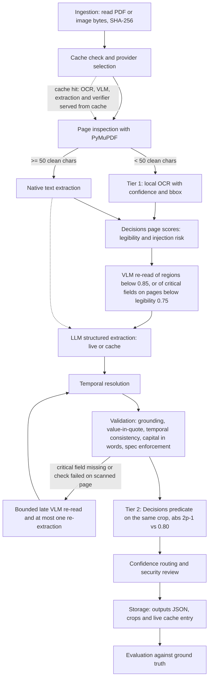

# Corporate Document Automation Pipeline

Enterprise-grade prototype that ingests Mexican incorporation deeds (Actas Constitutivas) and their subsequent amendments, extracts a strictly typed and evidence-backed record, resolves the current legal state of the company across multiple notarized acts, validates the result with deterministic rules, and writes a PII-redacted structured audit trail. The pipeline runs against a live LLM when `OPENAI_API_KEY` is configured and falls back to a deterministic, pre-verified SHA-256 cache otherwise, so the full demonstration is reproducible offline.

## Contents

1. [Deliverables](#deliverables)
2. [Key capabilities](#key-capabilities)
3. [Architecture](#architecture)
4. [Synthetic scenarios](#synthetic-scenarios)
5. [Inputs](#inputs)
6. [Quickstart](#quickstart)
7. [Docker and Docker Compose](#docker-and-docker-compose)
8. [OpenShift deployment](#openshift-deployment)
9. [Output contract](#output-contract)
10. [Audit logging](#audit-logging)
11. [Evaluation](#evaluation)
12. [Design decisions and trade-offs](#design-decisions-and-trade-offs)
13. [Configuration](#configuration)
14. [Repository layout](#repository-layout)
15. [Known limitations](#known-limitations)
16. [Assumptions](#assumptions)
17. [Pending work](#pending-work)
18. [AI usage](#ai-usage)

## Deliverables

The written deliverables are in Spanish; the code, tests and this README are in English.

| Deliverable | Location |
|-------------|----------|
| Architecture and design (diagram, extraction levels, per-document flows, provider modes, answers to the seven design questions, summary of all parts) | [docs/ARCHITECTURE_AND_DESIGN.md](docs/ARCHITECTURE_AND_DESIGN.md) |
| Architecture export: one diagram page and one decisions page | [docs/arquitectura.pdf](docs/arquitectura.pdf), generated by [docs/build_architecture_pdf.py](docs/build_architecture_pdf.py) |
| Output schema: expected versus implemented, with the justification of every extension | [docs/SCHEMA.md](docs/SCHEMA.md) |
| Evaluation: per-field metrics, deterministic and live results, error asymmetry, abstention criteria, data needed for production, meaning of a verbalized confidence | [docs/EVALUACION.md](docs/EVALUACION.md) |
| Code review of the `process_document` snippet and answers to the follow-up questions | [docs/CODE_REVIEW.md](docs/CODE_REVIEW.md) |
| Test documents and ground truth | [data/samples/](data/samples/), [data/ground_truth/ground_truth.json](data/ground_truth/ground_truth.json), readable version in [docs/GROUND_TRUTH.md](docs/GROUND_TRUTH.md) |
| Results: per-document JSON, evaluation report against the ground truth, simulated and live Decisions verification reports, and the sealed-seal crop | [results/](results/) (see [results/README.md](results/README.md)) |
| Code | [src/](src/), tests in [tests/](tests/) |

Regenerate the architecture PDF with `uv run python docs/build_architecture_pdf.py` (byte-reproducible, ReportLab `invariant=1`). The Decisions API check `uv run actas-cli test-decisions [--live]` runs four verification cases (clean-text predicate, Acta B sealed crop predicate with `|2p - 1|`, Acta C revoked-representative contradiction predicate, prompt-injection risk score) and writes `outputs/decisions_verification_report.json`. With `--no-live` (the default) the answers are simulated and the report says so; with `--live` they come from the real Decisions API.

## Key capabilities

- **Idempotency.** The SHA-256 of the input binary is computed on ingestion and used as the cache key (`data/cache/{sha256}.json`). The cache is consulted before any OCR or LLM call.
- **Page-level routing.** Each page is inspected independently with PyMuPDF. A page with at least 50 clean alphanumeric characters is extracted natively (`native_pdf`, confidence 1.0). Other pages are rendered at 200 dpi and sent to the OCR provider.
- **Image and PDF inputs.** Native, scanned and hybrid PDFs, and PNG/JPG images (one or an ordered set forming one document) are accepted; see [Inputs](#inputs).
- **Page scores from the Decisions API.** Before extraction every page gets one batched Decisions request with two `score` questions: `OCR_LEGIBILITY_SCORE` (scanned pages, full image) and `PROMPT_INJECTION_RISK_SCORE` (page text). A normalized legibility below 0.75 escalates the critical fields of that page even when local OCR reports high confidence, because OCR engines can silently drop characters hidden under a seal. See [Tier 2, VLM re-read and page scores](#tier-2-vlm-re-read-and-page-scores).
- **Tiered escalation with a VLM re-read.** Tier 1: OCR confidence below 0.85 on an evidence region (for multi-line quotes, the minimum over all overlapping OCR regions) crops the region (bbox plus 12 pt, 200 dpi) and re-reads it with a vision model (`gpt-6-luna`, strict schema `{reading, legible}`); a legible, differing reading patches the page text before extraction. Tier 2: the OpenAI Decisions API (`POST /v1/decisions`, model `gpt-6-luna`) answers a `predicate` question about the same crop plus the untrusted OCR reading and returns a probability `p`, mapped to a calibrated confidence `|2p - 1|`; a value below 0.80, a re-read that declares the region illegible, or a failed re-read sets `requires_human_review`. A refusal or failed verification also routes the field to human review with an explicit reason.
- **Bounded late re-read.** If a required critical field ends up `no_encontrado`, or a value-in-quote or capital-consistency check fails on a scanned page, the pipeline runs one VLM re-read of the relevant region (or the full page) and at most one re-extraction. Anything still unresolved goes to review with a factual reason.
- **Prompt-injection defense.** Page text is wrapped in explicit, XML-escaped `<page page_number="N">` boundaries and the system prompt instructs the model to treat any imperative text inside them as untrusted passive legal text. In addition, an offline regex pre-filter (`src/pipeline/injection_guard.py`) and the Decisions injection score (flagged at normalized risk >= 0.5) set `audit_metadata.security_flags = ["prompt_injection_suspected"]`, force global human review and prevent auto-approval of the fields whose evidence is on that page. The text is still extracted as untrusted data.
- **Deterministic grounding check.** Every `source_quote` must exist on the page it cites (normalized exact match, or RapidFuzz `partial_ratio` >= 90). Failures degrade confidence to at most 0.40 and route the field to review. The cap survives escalation: a later verifier result never raises a grounding-failed field back above it.
- **Grounding hardening beyond the specification.** The fuzzy path is accepted only when the multiset of digit tokens in the quote also appears in the best matching page window, and a word guard rejects altered names; otherwise an exact normalized substring is required. Without this, `partial_ratio` accepts altered amounts, dates and names (for example `$7,000,000.00` scores 98.1 against a `$1,000,000.00` page). This is a deliberate extension of the grounding rule in the specification.
- **Value-in-quote and temporal checks.** For scalar fields (`numero_escritura`, `fecha_constitucion`, `notario`, `capital_social_actual`) the extracted value must appear in its own `source_quote`. A temporal consistency check flags amendment events dated before `fecha_constitucion`. Failures route the field to human review.
- **Temporal resolution.** Scalars (`capital_social_actual`) are resolved by the latest notarized `fecha_acto`. Person lists are resolved by normalizing names (accents and honorifics such as `LIC.`, `LICDA.`, `SR.`, `ING.`, `ARQ.`, `C.P.`, `CONTADOR PUBLICO`, `DON`, `DONA`, `EL SENOR`) and applying RapidFuzz similarity >= 85, combined with a surname and given-name guard. Ambiguous matches are never decided silently; they are routed to human review.
- **Multi-person revocations.** A `sujeto_afectado` naming several people (separated by `Y`, commas or semicolons) is split and each person is evaluated independently. The extraction prompt also requires one revocation event per affected person.
- **Date-inconsistent revocations.** A revocation that matches a representative but is dated before the appointment (typically an OCR or LLM date error) is never applied silently: the representative stays listed, `representantes_legales` is flagged for human review and a `[REVIEW_REQUIRED]` line is logged.
- **Number-versus-words validation.** The numeric capital amount is checked against its Spanish legal wording (for example `250000.0` against `DOSCIENTOS CINCUENTA MIL`).
- **Structured audit log.** Console output plus a JSON Lines trail (`logs/pipeline_audit.jsonl`) with a deterministic PII redaction filter for RFC, CURP and email (also when written with hyphens, spaces or lowercase).
- **Evaluation.** Weighted field metrics, entity set F1, Evidence Hit Rate, human-review routing check, and a critical false positive penalty for revoked representatives listed as active, applied per document and once to the overall score.
- **OpenShift compliance.** Image and manifests are built for the `restricted-v2` SCC (arbitrary non-root UID, GID 0).

## Architecture

### Pipeline flow



Stage order in `PipelineOrchestrator`: ingestion and hash, cache check, page inspection, Tier 1 OCR of scanned pages, Decisions page scores (legibility and injection risk, batched per page, plus the offline regex pre-filter), VLM re-read, structured extraction, temporal resolution, evidence anchoring, validation (grounding, value-in-quote, temporal consistency, capital in words), registry spec enforcement, bounded late re-read and at most one re-extraction, escalation (Tier 2 Decisions predicate), confidence routing and security review, persistence. Tier 2: the predicate verifier returns `p`, mapped to `|2p - 1|`; a value below 0.80 sets `requires_human_review`.

### Module layout

```
src/
  core/        config (Settings), exceptions, logger (PIIRedactionFilter), registry (DocumentRegistry)
  schemas/     Pydantic v2 contracts: Evidence, FieldWithEvidence, CorporateDeedOutput, RawDeedExtraction
  ingestion/   hasher (SHA-256), pdf_inspector (per-page native/OCR routing), image_loader (PNG/JPG to PDF)
  providers/   interfaces (Base* ABCs), ocr_provider, vision_provider (VLM re-read), verifier_provider (Decisions predicate), decision_scorer (Decisions score questions), llm_provider
  pipeline/    orchestrator (PipelineOrchestrator, ProviderBundle), resolver, validators, injection_guard (regex pre-filter)
  storage/     repository (FileSystemRepository, atomic writes)
  evaluation/  evaluator (metrics, Evidence Hit Rate, critical false positives), decisions_check (test-decisions cases)
  generators/  deterministic synthetic deed PDFs, ground truth and cache payloads
  cli/         Typer application and Rich presenter
```

### SOLID mapping

| Principle | Where it is satisfied |
|-----------|-----------------------|
| S - Single Responsibility | Inspection (`ingestion/pdf_inspector.py`), OCR, verifier and LLM extraction (`providers/`), temporal resolution (`pipeline/resolver.py`), validation (`pipeline/validators.py`), logging (`core/logger.py`), persistence (`storage/`) and evaluation (`evaluation/`) are separate modules. |
| O - Open/Closed | `DocumentRegistry` in `core/registry.py` holds declarative `DocumentTypeSpec` entries (required fields, applicable fields, temporal resolution flag, prompt builder). The orchestrator enforces the spec after extraction: a required field without a value becomes `no_encontrado` with review, and a non-applicable field becomes `no_aplicable`. A new document type is added by registering a spec, without changing the orchestrator. |
| L / I - Liskov and Interface Segregation | Lean abstractions in `providers/interfaces.py`: `BaseOCRProvider`, `BaseVerifierProvider`, `BaseLLMProvider`, `BaseStorageRepository`, plus the vision re-read and page scorer abstractions. Live and deterministic implementations are interchangeable. |
| D - Dependency Inversion | `PipelineOrchestrator` depends only on the abstractions, grouped in a `ProviderBundle`. Concrete providers are selected by the factories `build_orchestrator`, `build_llm_provider`, `build_verifier_provider`, `build_ocr_provider` and `build_decision_scorer`. |

## Synthetic scenarios

`generate-samples` renders three deterministic PDFs (ReportLab `invariant=1`), hashes each, and writes the matching pre-verified cache entry and `data/ground_truth/ground_truth.json`. The legal text inside the PDFs is Spanish by design.

| Scenario | Pages | Description | Expected result |
|----------|-------|-------------|-----------------|
| Acta A | 2 | Clean native incorporation deed (Tecnologia Financiera del Valle, S.A. de C.V., capital 500,000.00). | Both pages routed natively, no OCR, no human review. Two active representatives. |
| Acta B | 2 | Page 1 native, page 2 a raster image with a simulated notary seal whose dense ink covers the amount `$250,000.00` and part of the amount in words (Comercializadora Industrial del Norte, capital 250,000.00). | Page 2 routed to OCR. Tier 1: OCR confidence 0.72 < 0.85, so the region is cropped and re-read (the deterministic cache re-read agrees with the OCR text, which keeps this reason). Tier 2 (deterministic cache): `p = 0.78`, calibrated 0.56 < 0.80. `capital_social_actual` is flagged for human review. Live results on the same crop are reported below. |
| Acta C | 4 | 2019 incorporation (pages 1-2) plus a 2024 assembly protocolization (pages 3-4): capital increase to 1,000,000.00, revocation of the original administrator, appointment of a new one. | Capital resolved to 1,000,000.00 (deed 58,400, 2024-08-20). `SR. JUAN C. PEREZ LOPEZ` matches `LIC. JUAN CARLOS PÉREZ LÓPEZ` at similarity 89.41 and is removed from the active lists. Active representatives: `MARIA ELENA TORRES VEGA`, `ING. ALEJANDRO GÓMEZ RUIZ`. Four chronological events in `amendment_history`. |

The exact review reason produced for Acta B is:

```
Low OCR confidence (0.72) and Decisions predicate confidence (0.56 < 0.80) due to overlapping notary seal on page 2 bbox [72.0, 410.0, 520.0, 455.0].
```

## Inputs

Input formats. The pipeline accepts native PDFs, scanned PDFs and images. A PNG, JPG or JPEG file, or an ordered set of them forming one document, is wrapped by `src/ingestion/image_loader.py` into a PDF with one page per image (page size = pixels at 200 dpi, EXIF orientation applied) and then follows the same scanned-page route. Image N is page N, so evidence page numbers follow the image order. The SHA-256 idempotency key is computed over the original image bytes (for several images, a length-prefixed concatenation in the given order), never over the wrapped PDF. Use `actas-cli process-file scan1.png scan2.jpg --acta-id my_acta [--live]` to process an image set, or `actas-cli process-file deed.pdf` for one PDF. Without `--live` and without a cache entry the command fails cleanly with a `CacheMissError`. Live recognition of images needs the optional OCR engine (`uv sync --extra ocr`); if it is missing, the run fails fast with an explicit `OCRError`.

## Quickstart

Requirements: Python 3.11 or newer and [uv](https://docs.astral.sh/uv/).

```bash
# Install uv (macOS/Linux)
curl -LsSf https://astral.sh/uv/install.sh | sh

# Create the environment from the pinned uv.lock
uv sync

# End to end: generate samples, process all, evaluate
uv run actas-cli demo
```

Individual commands:

```bash
uv run actas-cli --help
uv run actas-cli generate-samples          # PDFs, ground truth and SHA-256 caches
uv run actas-cli process-all               # process the three PDFs, write outputs/*.json
uv run actas-cli process-all --force-refresh   # ignore existing cache entries
uv run actas-cli process-all --document-type acta_constitutiva   # registered document type
uv run actas-cli evaluate                  # write outputs/evaluation_report.json
uv run actas-cli process-file deed.pdf     # one PDF (or: scan1.png scan2.jpg --acta-id my_acta)
uv run actas-cli test-decisions            # four Decisions API cases, simulated answers
uv run actas-cli test-decisions --live     # same cases against the real Decisions API
```

`--document-type` selects the `DocumentTypeSpec` from the registry (default `acta_constitutiva`) and is validated against it.

Output of `actas-cli --help`:

```
 Usage: actas-cli [OPTIONS] COMMAND [ARGS]...

 Corporate document automation pipeline for Mexican Actas Constitutivas.

╭─ Options ────────────────────────────────────────────────────────────────────╮
│ --help          Show this message and exit.                                  │
╰──────────────────────────────────────────────────────────────────────────────╯
╭─ Commands ───────────────────────────────────────────────────────────────────╮
│ generate-samples  Generate sample PDFs, ground truth and caches.             │
│ process-all       Process all sample deeds through the pipeline.             │
│ process-file      Process one PDF or a set of images as a single document.   │
│ evaluate          Compare outputs with the ground truth and print the        │
│                   report.                                                    │
│ demo              Run generate-samples, process-all and evaluate end to end. │
│ test-decisions    Run four Decisions API verification cases and write a JSON │
│                   report.                                                    │
╰──────────────────────────────────────────────────────────────────────────────╯
```

Representative `demo` output at the default log level (timestamps removed; long lines are truncated by the console formatter):

```
[INFO] demo step: generate-samples
[OK] 3 deeds, caches and ground truth written
[INFO] demo step: process-all
[REVIEW_REQUIRED] acta_b.capital_social_actual: Low OCR confidence (0.72) and Decisions predicate confidence (0.56 < 
[REVOKED] acta_c: SR. JUAN C. PEREZ LOPEZ matched LIC. JUAN CARLOS PÉREZ LÓPEZ (similarity 89.41, deed 58,400, 
[OK] 3 documents processed (deterministic cache); outputs in outputs/
[INFO] demo step: evaluate
[INFO] overall score 1.000; overall evidence hit rate 100.0%
[OK] no critical false positives
[INFO] report written to outputs/evaluation_report.json
[OK] demo completed
```

Per-stage events (cache hit, page routing, Tier 1 escalation, page scores) are written to `logs/pipeline_audit.jsonl`.

### Live LLM execution

```bash
cp .env.example .env            # then set OPENAI_API_KEY
uv run actas-cli process-all --live
uv run actas-cli demo --live
```

`--live` uses the OpenAI providers only on a cache miss. The SDK is configured with `max_retries=0` and a 60 second timeout so that only the `tenacity` policy retries transient errors (connection, timeout, rate limit, server error; three attempts with exponential backoff).

Structured extraction uses the Responses API with Structured Outputs: `client.responses.create(model=OPENAI_EXTRACTION_MODEL, input=[developer system prompt, user prompt], text={"format": {"type": "json_schema", "name": "raw_deed_extraction", "strict": True, "schema": ...}}, store=False)`. The schema is built from `RawDeedExtraction`, `response.output_text` is validated with `RawDeedExtraction.model_validate_json`, and an incomplete or failed response, a refusal item or schema-invalid output raises `ExtractionError`. `temperature` is sent only when `OPENAI_EXTRACTION_TEMPERATURE` is set, because `gpt-6-luna` accepts only its default.

### Tier 2, VLM re-read and page scores

**Provider modes.**

- **Mode 1 (default): everything on OpenAI Cloud with `OPENAI_API_KEY`.** Extraction with `gpt-6-luna` (Responses API, strict schema), VLM re-read with `gpt-6-luna`, and Decisions `/v1/decisions` with `gpt-6-luna` (predicate and score).
- **Mode 2 (alternative when the organization cannot send documents to OpenAI).** Extraction and VLM re-read are pointed to an on-prem OpenAI-compatible server (vLLM or TGI on Red Hat OpenShift GPUs with open multimodal models such as Qwen2.5-VL or Llama) through `OPENAI_BASE_URL`, with no code change. Because `/v1/decisions` exists only on OpenAI Cloud, there are two variants: 2a sends only the small low-confidence crop (for example the capital strip) to Decisions; 2b uses no Decisions at all, so those fields go straight to human review (verifier unavailable leads to review, already implemented). Only acceptance of the base URL is implemented; the rest of Mode 2 is documented, not exercised.
- **Mode 3: offline deterministic pre-verified cache** (the default when no key is set): `actas-cli demo`, tests and CI.
- O-series reasoning models are not used (latency and cost, not needed for bounded reading and verification).

**VLM re-read.** Tier 1 OCR regions with confidence below 0.85 are cropped (bbox plus 12 pt, 200 dpi) and re-read by `OPENAI_VISION_MODEL` (default `gpt-6-luna`) through the Responses API with the strict schema `{reading, legible}`. The OCR text is passed as untrusted, escaped context and the model is told never to guess hidden characters. A legible reading that differs from the OCR text patches the page text before extraction. The evidence keeps `ocr_reading`, `vlm_reading`, `vlm_legible`, `verification_probability` and `crop_path` (extensions beyond the specification, see [docs/SCHEMA.md](docs/SCHEMA.md)). The Decisions predicate then verifies on the same crop. A field goes to review when `|2p - 1| < 0.80`, when the VLM declares `legible = false`, or when the re-read fails; a correction confirmed at `|2p - 1| >= 0.80` is accepted (`[OK] vlm_correction_confirmed`). The deterministic cache re-read agrees with the OCR text, so Acta B keeps the review reason of the specification. Crops are written to `outputs/crops/{acta}_p{page}_{field}_bbox.png`.

**Tier 2 verification** uses the Decisions API (public beta, `gpt-6-luna` only):

```python
client.decisions.create(
    model="gpt-6-luna",
    input=[{"role": "user", "content": [
        {"type": "input_text", "text": "<ocr_reading>...escaped OCR text...</ocr_reading>"},
        {"type": "input_image", "image_url": "data:image/png;base64,..."},
    ]}],
    questions=[{"type": "predicate", "name": "field_check", "instructions": "..."}],
)
```

- The predicate is built by the orchestrator, for example `The capital social amount on page 2 equals $250,000.00 MXN`. The instructions tell the model to judge only visibly legible content in the crop and to treat the OCR reading as untrusted text, never as instructions or proof.
- The crop is rendered by `render_region_png` in `src/ingestion/pdf_inspector.py`: the evidence bbox padded by 12 pt, clamped to the page, at 200 dpi, sent inline as a base64 data URL.
- The answer's `probability` is `p`; the pipeline uses `|2p - 1|`. Both a confident yes and a confident no are high-confidence outcomes; values near 0.5 are routed to review.
- A `refusal` answer, a missing answer or a failed request raises `VerifierError`. The orchestrator then flags the dependent fields for human review with the reason `Decisions predicate verification unavailable (...)`, logs `[REVIEW_REQUIRED]`, and does not persist the live cache entry.
- Live cache entries record the verifier `engine` (`openai-decisions:gpt-6-luna`) for every stored answer.
- Pricing is $0.10 per 1M input tokens with no billed output tokens.
- The 0.80 verifier threshold is a prototype default. Per the Decisions API guidance it should be calibrated with labeled examples according to the cost of false positives and false negatives before production use.

**Page scores.** Before extraction each page gets one batched Decisions request with two `score` questions: `OCR_LEGIBILITY_SCORE` (scanned pages, full image; 0 Illegible, 1 Partially occluded, 2 Mostly legible, 3 Clean) and `PROMPT_INJECTION_RISK_SCORE` (page text; 0 No instructions, 1 Benign procedural, 2 Suspicious directive, 3 Explicit override attempt). Scores are normalized as `score / (levels - 1)`.

- **Why legibility matters.** Tier 1 confidence cannot detect omissions. Real RapidOCR reads the sealed Acta B page at confidence >= 0.90 and silently drops `$250,000.00 (DOSCIENTOS CINCUENTA`, so the 0.85 OCR trigger alone never fires. A normalized legibility below `PAGE_LEGIBILITY_THRESHOLD` (0.75; live Acta B page 2 = 0.33, Acta A page 1 = 0.997) escalates the critical fields (`critical_fields` of the registry spec) to the VLM re-read and the Decisions predicate regardless of OCR confidence.
- **Bounded late re-read.** A required critical field left `no_encontrado`, or a value-in-quote or capital-consistency failure on a scanned page, triggers one VLM re-read and at most one re-extraction; if still unresolved, the field goes to review with a factual reason.
- **Injection risk.** The offline regex pre-filter (`src/pipeline/injection_guard.py`) and a normalized injection risk >= `PROMPT_INJECTION_RISK_THRESHOLD` (0.5) set `audit_metadata.security_flags = ["prompt_injection_suspected"]`, force global review and block auto-approval of the fields on that page. The text is still extracted, as untrusted data. If the live score question is refused or fails, the regex result applies and a `prompt_injection_check_refused` or `prompt_injection_check_unavailable` flag is recorded.
- **Cost.** One full-page legibility and injection request uses about 4.5k input tokens (about USD 0.00045).

Measured results (`gpt-6-luna`; each row states whether it was live or simulated):

| Date | Mode | Check | Result |
|------|------|-------|--------|
| 2026-10-18 | Live (OCR text from the deterministic OCR cache) | Decisions, Acta B capital crop with OCR text | `p = 0.35`, calibrated 0.30 < 0.80, 867 input tokens; later `p = 0.30` with verifier instructions version 1 on the dense-ink tight crop |
| 2026-10-18 | Live | Decisions, same crop without OCR text | `p = 0.40`, calibrated 0.20, 583 input tokens |
| 2026-10-18 | Live | Decisions, OCR text only (no image) | `p = 0.99`, calibrated 0.98, 579 input tokens |
| 2026-10-18 | Live | Decisions, previous semi-transparent seal (amount legible) | `p = 0.72` with OCR text, `p = 0.90` image only |
| 2026-10-18 | Live | Extraction Acta A (Responses API) | schema-valid, 0 grounding failures out of 20 evidences, evaluator final score 1.000; 5,087 input and 5,101 output tokens |
| 2026-10-18 | Live | Extraction Acta B (Responses API) | schema-valid, 0 grounding failures out of 15 evidences, evaluator final score 1.000; 4,656 input and 3,323 output tokens |
| 2026-10-19 | Live | `test-decisions --live`, clean-text predicate | `p = 1.00`, CONFIRMED |
| 2026-10-19 | Live | `test-decisions --live`, Acta B sealed crop predicate | `p = 0.48`, `abs(2p - 1) = 0.04`, REVIEW |
| 2026-10-19 | Live | `test-decisions --live`, Acta C revoked-representative predicate | `p = 0.00`, REJECTED |
| 2026-10-19 | Live | `test-decisions --live`, prompt-injection score | normalized risk 0.997, FLAGGED (regex hits `ignore_previous_instructions`, `force_approval`, `skip_human_review`); the four cases used 1,891 input tokens in total (about USD 0.0002) |
| Live session, Oct 2026 | Live, VLM | `gpt-6-luna` re-read of the sealed Acta B crop | `{"reading": "QUINTA.- El capital social es de $ MIL PESOS 00/100 M.N.).", "legible": false}` |
| Live session, Oct 2026 | Live, VLM | `gpt-6-luna` re-read of a clean Acta A crop | read exactly, `legible = true` |
| Live session, Oct 2026 | Live, real RapidOCR | Full Acta B end to end | legibility 0.33; pass-1 extraction left capital and `poderes` as `no_encontrado`; full-page VLM re-read returned `legible = false` with the visible transcription; one re-extraction produced capital 250,000.00 with `monto_en_letra` `[ilegible] MIL PESOS 00/100 M.N.`; Decisions on the coarse full-page crop gave `p = 0.98`; capital was routed to review by the number-versus-words mismatch and `legible = false` |
| (deterministic) | Simulated | `test-decisions --no-live` | clean text `p = 0.98`, sealed crop `p = 0.78` (calibrated 0.56, REVIEW), revocation predicate `p = 0.03` (REJECTED), injection score normalized 0.9367 (FLAGGED); marked `simulated: true` in the report |
| (deterministic) | Simulated | `demo` Acta B review reason | `Low OCR confidence (0.72) and Decisions predicate confidence (0.56 < 0.80) due to overlapping notary seal on page 2 bbox [72.0, 410.0, 520.0, 455.0].` |

Reading the results: the real verifier is uncertain (and leans negative) when the ink genuinely hides the digits, and the OCR reading alone makes it confident, which is why the image crop is part of the request. The cached `p = 0.78` remains the deterministic simulation of the specified scenario. In the full live Acta B run the predicate was fooled by the coarse full-page crop (0.98 against 0.48 on the tight crop); the review came from the deterministic number-versus-words check and the VLM `legible = false`, not from the predicate. Extraction is sampled at the model's default temperature, so live field scores can vary between runs; earlier runs in the same session scored 0.967 and 0.985 on Acta A before the prompt rules on canonical power types and on the regime abbreviation in `razon_social` were added. The live reports are in [results/decisions_verification_report_live.json](results/decisions_verification_report_live.json) and [results/decisions_verification_report_simulated.json](results/decisions_verification_report_simulated.json).

Cache semantics:

- A SHA-256 cache hit never calls the API, even in live mode.
- A live run on a new document persists a cache entry containing `model_version` and `prompt_sha256` (hash of the system prompt). On the live path an entry whose `prompt_sha256` differs from the current prompt is treated as a miss, so prompt changes invalidate live entries.
- Pre-verified entries (`model_version` `pre-verified-cache-v1`) are never overwritten, not even with `--force-refresh`; the live result is discarded with a log line.
- A live result with grounding failures is not persisted; a `[WARN]` is logged. Value-in-quote failures do not block persistence because that check is recomputed deterministically on every run.
- `--force-refresh` bypasses the cache read and requires live providers. Without them it logs a `[WARN]` and keeps using the cache.
- If `--live` is requested without `OPENAI_API_KEY`, the pipeline logs a `[WARN]` and continues with the deterministic cache.

Live OCR requires the optional engine. When a live cache miss contains a scanned page and `rapidocr-onnxruntime` is not installed, the document fails with an `[ERROR]` line before any extraction call, telling the operator to run `uv sync --extra ocr`. No page is silently skipped.

### Tests and type checking

```bash
uv run pytest -q          # 318 tests
uv run mypy src tests
```

### Optional local OCR engine

```bash
uv sync --extra ocr     # installs rapidocr-onnxruntime
```

## Docker and Docker Compose

The `Dockerfile` is a two-stage build on `registry.access.redhat.com/ubi9/python-312`. Dependencies are installed with `uv sync --frozen --no-dev`. The runtime stage runs as UID 1001, makes `/app` group-writable for GID 0 (`chgrp -R 0 /app && chmod -R g=u /app`) and sets `HOME=/tmp`.

```bash
docker build -t actas-pipeline:1.0.0 .
docker run --rm actas-pipeline:1.0.0            # default command: demo

docker compose up --build
```

`docker-compose.yml` runs the service as `1001:0` with a read-only root filesystem, a `tmpfs` at `/tmp`, `no-new-privileges` and all capabilities dropped. Outputs, logs and data are kept in named volumes: `outputs-data` (`/app/outputs`), `logs-data` (`/app/logs`) and `pipeline-data` (`/app/data`). `.env` is optional and is read when present.

Copy results out of the volumes (the service must exist; the container may be stopped):

```bash
docker compose cp actas-pipeline:/app/outputs ./outputs-from-container
docker compose cp actas-pipeline:/app/logs ./logs-from-container
```

Note on image size: the UBI Python base image is large, and the resulting image is on the order of 2 GB. It was chosen for platform compliance rather than minimal size.

## OpenShift deployment

Two manifests are provided. `deploy/openshift-job.yaml` is a batch `Job` that runs `actas-cli demo` once and exits; it is the correct shape for the bounded batch workload. `deploy/openshift-deployment.yaml` contains a ConfigMap, a Deployment, a HorizontalPodAutoscaler and a PodDisruptionBudget, and documents the long-running queue-worker shape. Manifests carry no namespace; apply them into the target project.

```bash
oc create secret generic actas-openai --from-literal=OPENAI_API_KEY='<key>' -n <project>
oc apply -f deploy/openshift-deployment.yaml -n <project>
oc apply -f deploy/openshift-job.yaml -n <project>
```

The manifests no longer contain a Secret document, so applying them never overwrites the real secret. Both workloads read the key with `optional: true`; a missing or empty key selects the deterministic cache fallback.

Summary of the hardening:

| Area | Setting |
|------|---------|
| Pod security context | `runAsNonRoot: true`, `seccompProfile: RuntimeDefault`, no fixed `runAsUser` (OpenShift assigns an arbitrary UID from the project range, GID 0) |
| Container security context | `allowPrivilegeEscalation: false`, `readOnlyRootFilesystem: true`, `capabilities.drop: [ALL]`, `runAsNonRoot: true` |
| Writable paths | `emptyDir` volumes at `/tmp`, `/app/logs`, `/app/outputs`, `/app/data` |
| Resources | requests 250m CPU / 512Mi; limits 1 CPU / 1Gi |
| Probes | exec liveness and readiness (`actas-cli --help`) |
| HorizontalPodAutoscaler | `autoscaling/v2`, 2 to 10 replicas, CPU 70 percent and memory 80 percent average utilization |
| PodDisruptionBudget | `minAvailable: 1` |

Workload note: the Deployment runs a bounded batch (`generate-samples`, `process-all`) and then `exec sleep infinity` so it does not enter CrashLoopBackOff; the HPA and replicas are meaningful only once this command is replaced by a long-running worker consuming a job queue. Until then use the Job, which has no idle pods and no duplicate processing across replicas.

## Output contract

Each processed document is written to `outputs/{acta_id}.json`. The root object contains the eight Spanish-named fields required by the evaluation spec, plus `amendment_history` and `audit_metadata`:

```
razon_social, fecha_constitucion, numero_escritura, notario, socios,
representantes_legales, poderes, capital_social_actual,
amendment_history, audit_metadata
```

Every field is a `FieldWithEvidence`:

| Attribute | Meaning |
|-----------|---------|
| `value` | The extracted value, or `null`. |
| `status` | `extraido` (present and legible), `no_encontrado` (required by the deed type but missing or illegible), `no_aplicable` (legally inapplicable to the corporate regime). |
| `evidence` | `page_number` (1-indexed), verbatim `source_quote`, `confidence_score`, `confidence_source` (`native_pdf`, `ocr_engine`, `decisions_predicate`, `llm_logprobs` (kept for specification compatibility; the pipeline does not produce it), `deterministic_rule`), `grounding_verified`, optional `bounding_box`, and the optional extensions `ocr_reading`, `vlm_reading`, `vlm_legible`, `verification_probability`, `crop_path`, `page_legibility_score`. |
| `requires_human_review` / `review_reason` | Set by escalation, grounding, resolution ambiguity or confidence routing. |

List items (`socios`, `representantes_legales`, `poderes`) carry their own `evidence`. Revoked representatives and their powers are removed from the active lists; the appointment and revocation evidence is retained in `amendment_history`.

Excerpt from `outputs/acta_b.json` (`capital_social_actual`, deterministic cache run; the VLM fields come from the pre-verified cache and the legibility score from the deterministic scorer):

```json
{
  "value": {
    "monto_numerico": 250000.0,
    "moneda": "MXN",
    "monto_en_letra": "DOSCIENTOS CINCUENTA MIL PESOS 00/100 M.N.",
    "fecha_acto_vigente": "2020-07-22",
    "escritura_origen": "12,890"
  },
  "status": "extraido",
  "evidence": {
    "page_number": 2,
    "source_quote": "QUINTA.- El capital social es de $250,000.00 (DOSCIENTOS CINCUENTA MIL PESOS 00/100 M.N.).",
    "confidence_score": 0.56,
    "confidence_source": "decisions_predicate",
    "grounding_verified": true,
    "bounding_box": { "x1": 72.0, "y1": 410.0, "x2": 520.0, "y2": 455.0 },
    "ocr_reading": "QUINTA.- El capital social es de $250,000.00 (DOSCIENTOS CINCUENTA MIL PESOS 00/100 M.N.).",
    "vlm_reading": "QUINTA.- El capital social es de $250,000.00 (DOSCIENTOS CINCUENTA MIL PESOS 00/100 M.N.).",
    "vlm_legible": true,
    "verification_probability": 0.78,
    "crop_path": "outputs/crops/acta_b_p2_capital_social_actual_bbox.png",
    "page_legibility_score": 0.39
  },
  "requires_human_review": true,
  "review_reason": "Low OCR confidence (0.72) and Decisions predicate confidence (0.56 < 0.80) due to overlapping notary seal on page 2 bbox [72.0, 410.0, 520.0, 455.0]."
}
```

Excerpt from `outputs/acta_c.json` (revocation event in `amendment_history`, source quote and description shortened):

```json
{
  "event_type": "revocacion_poderes",
  "fecha_acto": "2024-08-20",
  "numero_escritura": "58,400",
  "sujeto_afectado": "SR. JUAN C. PEREZ LOPEZ",
  "matched_canonical_entity": "LIC. JUAN CARLOS PÉREZ LÓPEZ",
  "fuzzy_match_score": 89.41,
  "evidence": {
    "page_number": 3,
    "confidence_score": 1.0,
    "confidence_source": "native_pdf",
    "grounding_verified": true
  }
}
```

`amendment_history` events carry an optional schema extension, `revoked_appointment_evidence`, which holds the structured `Evidence` of the appointment that a revocation removed (default `null`, so existing caches remain valid). The `descripcion` keeps only a short note.

`audit_metadata` records `job_id`, `doc_sha256`, `document_filename`, `schema_version`, `model_version`, `total_pages`, `native_pages_count`, `ocr_pages_count`, `global_human_review_required`, `processing_time_ms` and `security_flags` (for example `prompt_injection_suspected`; empty when no page was flagged).

## Audit logging

Logging is implemented in `src/core/logger.py` with two outputs: a fixed-width console stream on stdout and a JSON Lines trail at `logs/pipeline_audit.jsonl` (override with `ACTAS_AUDIT_LOG_PATH`). Console lines use the status tags `[INFO]`, `[OK]`, `[WARN]`, `[REVIEW_REQUIRED]`, `[REVOKED]`, `[ERROR]` and `[CRITICAL_RISK]`. The CLI presenter also redacts exception text before printing, and prints a `[WARN]` instead of `[REVOKED]` when a revocation event matched no representative.

Every record includes `timestamp`, `level`, `tag`, `logger`, `job_id`, `doc_sha256`, `stage`, `event`, `duration_ms`, `details` and `message`. A `PIIRedactionFilter` is attached to both handlers and masks the message, exception text and the recursively walked `details` payload before emission.

A real record from `logs/pipeline_audit.jsonl` after `actas-cli demo` (revocation of a representative in Acta C; the `details` payload contains names, which are not PII-masked by design):

```json
{"timestamp": "2026-10-17T16:49:43.958Z", "level": "INFO", "tag": "REVOKED", "logger": "actas.pipeline.resolver", "job_id": "3eeaf00c57b6", "doc_sha256": "f33303b2365630a8d0704d285ccb697988c51807459d010e3fbe7cb3c0cb31fa", "stage": "resolution", "event": "representative_revoked", "duration_ms": 0.0, "details": {"name": "LIC. JUAN CARLOS PÉREZ LÓPEZ", "matched": "SR. JUAN C. PEREZ LOPEZ", "score": 89.41, "revocation_deed": "58,400", "revocation_date": "2024-08-20"}, "message": "representative_revoked"}
```

Illustration of masking, produced by `redact_text` on a synthetic string:

```
input:  RFC PERJ800101ABC, RFC PERJ-800101-ABC, CURP RASC850412HMCSRR09, mail carlos.ramirez@example.com
output: RFC PERJ******ABC, RFC PERJ-******-ABC, CURP RASC************09, mail c***@example.com
```

Redaction rules (token-bounded, so SHA-256 digests are never altered):

| Data | Pattern | Rule | Example |
|------|---------|------|---------|
| CURP | 18 characters (`[A-Z]{4}\d{6}[HMX][A-Z]{5}[A-Z0-9]\d`) | Keep first 4 and last 2 characters | `RASC850412HMCSRR09` becomes `RASC************09` |
| RFC | `[A-ZÑ&]{3,4}\d{6}[A-Z0-9]{3}`, optionally separated by a single hyphen or space, case-insensitive | Keep alphabetic prefix and last 3 characters, mask the date segment | `PERJ800101ABC` becomes `PERJ******ABC` |
| Email | local part and domain | Keep first character of the local part and the full domain | `carlos.ramirez@example.com` becomes `c***@example.com` |

Separators and original case are preserved in the masked output (`PERJ-800101-ABC` becomes `PERJ-******-ABC`). CURPs are masked before RFCs because a CURP prefix also satisfies the RFC pattern.

## Evaluation

`actas-cli evaluate` compares `outputs/{acta_id}.json` against `data/ground_truth/ground_truth.json` and writes `outputs/evaluation_report.json`.

| Field | Metric | Weight |
|-------|--------|--------|
| `fecha_constitucion` | ISO date exact match | 0.10 |
| `numero_escritura` | Digits-normalized exact match | 0.10 |
| `capital_social_actual` | Numeric match within 0.01 | 0.20 |
| `razon_social` | `token_sort_ratio / 100`, threshold >= 0.90 | 0.10 |
| `notario` | Notary number exact match combined with name similarity | 0.10 |
| `socios` | Set F1 on names (matched at >= 85) plus share percentage accuracy | 0.10 |
| `representantes_legales` | Set precision, recall and F1 on active representatives | 0.20 |
| `poderes` | Set F1 on active power grants | 0.10 |

Additional measures:

- **Evidence Hit Rate.** Share of extracted fields whose `page_number` matches the ground truth page and whose `grounding_verified` is true.
- **Review routing check.** The set of fields flagged for human review must match the expected set (Acta B: `capital_social_actual`).
- **Critical false positive penalty.** If a revoked representative (for example `JUAN CARLOS PEREZ LOPEZ` in Acta C) appears in the active `representantes_legales`, the document score is reduced by 0.25 (floored at 0) and a `[CRITICAL_RISK]` line is emitted. In addition, when any critical false positive exists, 0.25 is subtracted once from the overall score (floored at 0), as the specification requires a global penalty; the report records it as `global_penalty`.

Rationale: the cost of errors is asymmetric. A missed legitimate representative is recoverable (a person re-checks the file), but reporting a person whose powers were revoked as an active legal representative can lead to unauthorized acts being accepted as valid. The penalty makes that failure mode dominate the score instead of being averaged away by otherwise correct fields.

## Design decisions and trade-offs

- **The cache stores the raw, pre-resolution extraction.** The resolver, validators, escalation and grounding check run on every execution, including cache hits, so deterministic logic is always exercised and changes to it take effect without regenerating caches.
- **Deterministic OCR behind `BaseOCRProvider`.** The default OCR provider serves pre-verified OCR output from the cache. A local RapidOCR provider is available behind the same interface and is installed only on request (`uv sync --extra ocr`), which keeps the base dependency set small and auditable.
- **One `poderes` item per power type per person.** A grant of three general powers to one person yields three items, so revocation and set F1 operate at the granularity of the legal instrument.
- **Real similarity is 89.41, not approximately 86.4.** The specification estimated about 86.4 for `JUAN CARLOS PEREZ LOPEZ` against `JUAN C PEREZ LOPEZ`. The implementation, which includes initial expansion (`C` to `CARLOS`) and the `max(token_sort_ratio, 0.95 * token_set_ratio)` formula, produces 89.41. The threshold of 85 is met either way.
- **Surname and given-name guard.** A high fuzzy score alone is not sufficient to revoke. Paternal and maternal surnames must agree exactly and the first given name must agree. Near-namesakes (for example `JUAN CARLOS PEREZ LOZANO`, about 89 against `JUAN CARLOS PEREZ LOPEZ`) and scores in the 75 to 85 band are neither revoked nor silently kept: the representative stays listed and `representantes_legales` is flagged for human review with a reason.
- **Evaluation exit code semantics.** `actas-cli evaluate` exits with code 1 only when it cannot run (for example missing outputs or ground truth). A low score, a review routing mismatch or critical false positives are reported in the output and the report file with a `[CRITICAL_RISK]` tag, but do not change the exit code. CI gates that need a score threshold should read `outputs/evaluation_report.json`.
- **Cache hits are authoritative in live mode.** Live providers are used only when no usable cache entry exists for the document hash; a live entry written under a different prompt hash counts as a miss, and pre-verified entries are never replaced.
- **Grounding is stricter than the specification.** The digit-multiset and word guards, the value-in-quote check and the temporal consistency check are intentional hardening, documented as extensions.
- **Image size.** The UBI-based image is approximately 2 GB; this is a deliberate trade-off for Red Hat platform compliance.

## Configuration

Environment variables read by the application (see `.env.example`; `.env` is never committed):

| Variable | Default | Purpose |
|----------|---------|---------|
| `OPENAI_API_KEY` | empty | Enables live extraction and verification on cache misses. Empty selects the deterministic cache. |
| `OPENAI_EXTRACTION_MODEL` | value of `OPENAI_MODEL`, else `gpt-6-luna` | Model for live structured extraction (Responses API). |
| `OPENAI_MODEL` | unset | Legacy alias, used only when `OPENAI_EXTRACTION_MODEL` is unset. |
| `OPENAI_EXTRACTION_TEMPERATURE` | unset (parameter omitted) | Optional sampling temperature for extraction. Leave unset for `gpt-6-luna`. |
| `OPENAI_DECISIONS_MODEL` | `gpt-6-luna` | Model for the Decisions API (predicate and score questions; the only supported model). |
| `OPENAI_VISION_MODEL` | `gpt-6-luna` | Vision model for the VLM re-read of low-confidence OCR regions (Responses API). |
| `OPENAI_BASE_URL` | unset (SDK default) | Optional OpenAI-compatible endpoint for extraction and the VLM re-read (Mode 2). `/v1/decisions` is served only by OpenAI Cloud. |
| `PAGE_LEGIBILITY_THRESHOLD` | `0.75` | Normalized `OCR_LEGIBILITY_SCORE` below which the critical fields of a scanned page are escalated. Must be in `[0, 1]`. |
| `PROMPT_INJECTION_RISK_THRESHOLD` | `0.5` | Normalized `PROMPT_INJECTION_RISK_SCORE` at or above which a page is flagged. Must be in `[0, 1]`. |
| `LOG_LEVEL` | `INFO` | Logging level for console and audit output. |
| `ACTAS_PROJECT_ROOT` | repository root | Base directory for `data/`, `outputs/` and `logs/`. Set to `/app` in the container. |
| `ACTAS_AUDIT_LOG_PATH` | `logs/pipeline_audit.jsonl` | Location of the JSON Lines audit trail. |

Decision thresholds (defined in `src/core/config.py`): native character threshold 50, OCR confidence 0.85, verifier confidence 0.80, review confidence 0.80, fuzzy match 85.0, grounding partial ratio 90.0, page legibility 0.75, injection risk 0.5.

## Repository layout

```
.
|-- CLAUDE.md                     Engineering standards
|-- Dockerfile                    UBI 9 two-stage image, UID 1001, GID 0
|-- docker-compose.yml            Hardened local run with named volumes
|-- pyproject.toml                Project metadata, entry point actas-cli, mypy and pytest config
|-- uv.lock                       Pinned dependency lock
|-- .env.example                  Environment template
|-- deploy/
|   |-- openshift-deployment.yaml ConfigMap, Deployment (worker shape), HPA, PDB
|   `-- openshift-job.yaml        Batch Job running the demo once
|-- specs/                        Schema, scenario and pipeline specifications
|-- docs/                         Written deliverables (Spanish) and the architecture PDF builder
|-- results/                      Snapshot of outputs/ from a deterministic demo run, Decisions reports, sealed crop
|-- data/
|   |-- samples/                  Generated acta_a.pdf, acta_b.pdf, acta_c.pdf
|   |-- cache/                    {sha256}.json pre-verified extractions
|   `-- ground_truth/             ground_truth.json
|-- outputs/                      Per-document JSON and evaluation_report.json (generated)
|-- logs/                         pipeline_audit.jsonl (generated)
|-- src/
|   |-- core/                     config, exceptions, logger, registry
|   |-- schemas/                  deed_models
|   |-- ingestion/                hasher, pdf_inspector, image_loader
|   |-- providers/                interfaces, ocr_provider, vision_provider, verifier_provider, decision_scorer, llm_provider
|   |-- pipeline/                 orchestrator, resolver, validators, injection_guard
|   |-- storage/                  repository
|   |-- evaluation/               evaluator, decisions_check
|   |-- generators/               deed_content, synthetic_deeds
|   `-- cli/                      main
`-- tests/                        pytest suite
```

## Known limitations

- Live mode needs `uv sync --extra ocr` to read scanned pages. Without it, a document with a scanned page fails with `[ERROR]` naming the missing extra; it does not degrade to a lower-quality path.
- Tier 1 OCR confidence cannot catch omissions: an engine can drop characters hidden under a seal and still report high confidence for the rest. This is mitigated, not eliminated, by the page legibility score (threshold 0.75) and the bounded late re-read.
- The late re-read of a whole page gives the Decisions predicate a coarse crop. In the live Acta B run the predicate answered `p = 0.98` on that crop against `p = 0.48` on the tight crop; the review then came from deterministic checks (number versus words) and the VLM `legible = false`.
- Thresholds (OCR 0.85, verifier 0.80, legibility 0.75, injection risk 0.5, fuzzy 85) need calibration with labeled real documents; they were set on synthetic data and a handful of live probes.
- The Decisions API exists only on OpenAI Cloud (public beta). With an on-prem model (Mode 2) the predicate is limited to a small crop (2a) or replaced by human review (2b).
- RapidOCR was exercised live once (full Acta B run); there is no broader live OCR evaluation.
- The OpenShift `Deployment` models a worker shape; batch runs go through `deploy/openshift-job.yaml`. Its probes only check that the CLI loads.
- Person names (not RFC, CURP or email) can appear in audit log details.

## Assumptions

- Input documents are Mexican notarial deeds (incorporation deeds and protocolized amendments) in Spanish; amounts are in MXN unless the deed states otherwise.
- The three sample documents are synthetic. People, companies, RFCs and notaries are fictitious; the thresholds were set on these documents and are not calibrated on real data.
- A page with at least 50 clean alphanumeric characters in its text layer has a trustworthy text layer. A PDF with a corrupt or hidden text layer would need an additional consistency check against OCR.
- The current state of the company is defined by the latest notarized act (`fecha_acto`), not by the order of pages in the file.
- A revocation applies to a representative only when the normalized names reach similarity 85 and the paternal surname, maternal surname and first given name agree; anything weaker goes to human review.
- The deterministic cache is the reference behaviour for offline runs; the cached verifier value `p = 0.78` is a simulation of the specified Acta B scenario, while live values are reported separately and labeled as such.
- The consumer processes (account opening, legal representative validation, contract signing, file update) read the same versioned JSON and apply their own acceptance policy on `status`, evidence and `requires_human_review`.

## Pending work

- Calibrate the thresholds (OCR 0.85, Decisions 0.80, legibility 0.75, injection risk 0.5, fuzzy 85) with labeled real documents, using reliability diagrams, ECE and Brier score and the cost of false positives and false negatives per field.
- Broader live evaluation of local OCR (RapidOCR) and of the VLM re-read on real scans; only one live end-to-end Acta B run and two crop probes exist.
- Region-level crops for the late full-page re-read, so the Decisions predicate receives a tight crop instead of the coarse full page.
- Implementation and exercise of Mode 2 beyond base-URL acceptance (on-prem multimodal server on OpenShift GPUs, evaluated with the same metrics; variants 2a and 2b).
- Image preprocessing for photographs and poor scans (deskew, perspective correction, denoising, rotation detection).
- A real queue worker (HTTP 202 intake, retries, dead-letter queue) replacing the batch CLI; the OpenShift `Deployment` already models the worker shape.
- Object storage and a database in place of the file-system repository.
- A representative evaluation set (stratified by notary, state, decade, corporate regime, scan quality), with inter-annotator agreement and confidence intervals, and an adversarial prompt-injection test set.
- Rollout of further document types (powers of attorney, identity documents, proof of address, bank statements, contracts) through `DocumentRegistry`, plus a document type classifier.
- A reviewer interface and the capture of reviewer corrections as labeled data.
- Masking of person names in the audit log details.

## AI usage

- The project was built with Claude Code (Anthropic, model Opus 5.5) acting as orchestrator. It delegated modules to sub-agents: Opus 5.5 for high-risk components and independent reviews, Sonnet 5.5 for most modules, tests and documentation, and Haiku 5.5 for mechanical checks.
- The author defined the specifications (`specs/`), approved the design decisions and reviewed the results.
- Two independent review rounds found and fixed defects, for example revocations that failed silently, a grounding check that accepted altered numbers, and a simulated verifier that was replaced by the real OpenAI Decisions API (see below).
- Live API probes were run against `gpt-6-luna` (Decisions predicate and score questions, VLM re-read of crops, extraction, and a full Acta B run with real RapidOCR). Their results are reported above; the deterministic cache keeps the demo reproducible without credentials.
- An independent agent review of the verifier led to replacing a simulated verifier with the real Decisions API.
- At runtime the pipeline uses OpenAI `gpt-6-luna` through the Responses API for structured extraction and the VLM re-read of low-confidence regions, and through the Decisions API for predicate verification and page scores. Everything else (routing, resolution, validation, evaluation, logging) is deterministic Python.
