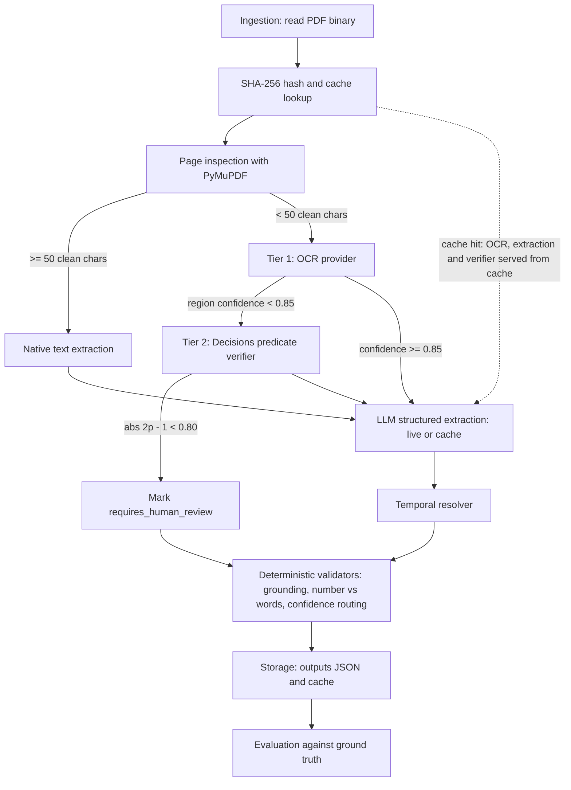

# Corporate Document Automation Pipeline

Bank-grade prototype that ingests Mexican incorporation deeds (Actas Constitutivas) and their subsequent amendments, extracts a strictly typed and evidence-backed record, resolves the current legal state of the company across multiple notarized acts, validates the result with deterministic rules, and writes a PII-redacted structured audit trail. The pipeline runs against a live LLM when `OPENAI_API_KEY` is configured and falls back to a deterministic, pre-verified SHA-256 cache otherwise, so the full demonstration is reproducible offline.

## Contents

1. [Key capabilities](#key-capabilities)
2. [Architecture](#architecture)
3. [Synthetic scenarios](#synthetic-scenarios)
4. [Quickstart](#quickstart)
5. [Docker and Docker Compose](#docker-and-docker-compose)
6. [OpenShift deployment](#openshift-deployment)
7. [Output contract](#output-contract)
8. [Audit logging](#audit-logging)
9. [Evaluation](#evaluation)
10. [Design decisions and trade-offs](#design-decisions-and-trade-offs)
11. [Configuration](#configuration)
12. [Repository layout](#repository-layout)

## Key capabilities

- **Idempotency.** The SHA-256 of the input binary is computed on ingestion and used as the cache key (`data/cache/{sha256}.json`). The cache is consulted before any OCR or LLM call.
- **Page-level routing.** Each page is inspected independently with PyMuPDF. A page with at least 50 clean alphanumeric characters is extracted natively (`native_pdf`, confidence 1.0). Other pages are rendered at 200 dpi and sent to the OCR provider.
- **Two-tier escalation.** Tier 1: OCR confidence below 0.85 on an evidence region escalates it. Tier 2: a predicate verifier (the "Decisions" verifier) returns a probability `p`, mapped to a calibrated confidence `|2p - 1|`; a value below 0.80 sets `requires_human_review`.
- **Prompt-injection defense.** Page text is wrapped in explicit `<page page_number="N">` XML boundaries and the system prompt instructs the model to treat any imperative text inside them as untrusted passive legal text.
- **Deterministic grounding check.** Every `source_quote` must exist on the page it cites (normalized exact match, or RapidFuzz `partial_ratio` >= 90). Failures degrade confidence to at most 0.40 and route the field to review.
- **Temporal resolution.** Scalars (`capital_social_actual`) are resolved by the latest notarized `fecha_acto`. Person lists are resolved by normalizing names (accents, titles such as `LIC.`, `SR.`, `ING.`) and applying RapidFuzz similarity >= 85, combined with a surname and given-name guard. Ambiguous matches are never decided silently; they are routed to human review.
- **Number-versus-words validation.** The numeric capital amount is checked against its Spanish legal wording (for example `250000.0` against `DOSCIENTOS CINCUENTA MIL`).
- **Structured audit log.** Console output plus a JSON Lines trail (`logs/pipeline_audit.jsonl`) with a deterministic PII redaction filter for RFC, CURP and email.
- **Evaluation.** Weighted field metrics, entity set F1, Evidence Hit Rate, human-review routing check, and a critical false positive penalty for revoked representatives listed as active.
- **OpenShift compliance.** Image and manifests are built for the `restricted-v2` SCC (arbitrary non-root UID, GID 0).

## Architecture

### Pipeline flow



### Module layout

```
src/
  core/        config (Settings), exceptions, logger (PIIRedactionFilter), registry (DocumentRegistry)
  schemas/     Pydantic v2 contracts: Evidence, FieldWithEvidence, CorporateDeedOutput, RawDeedExtraction
  ingestion/   hasher (SHA-256), pdf_inspector (per-page native/OCR routing)
  providers/   interfaces (Base* ABCs), ocr_provider, verifier_provider, llm_provider
  pipeline/    orchestrator (PipelineOrchestrator, ProviderBundle), resolver, validators
  storage/     repository (FileSystemRepository, atomic writes)
  evaluation/  evaluator (metrics, Evidence Hit Rate, critical false positives)
  generators/  deterministic synthetic deed PDFs, ground truth and cache payloads
  cli/         Typer application and Rich presenter
```

### SOLID mapping

| Principle | Where it is satisfied |
|-----------|-----------------------|
| S - Single Responsibility | Inspection (`ingestion/pdf_inspector.py`), OCR, verifier and LLM extraction (`providers/`), temporal resolution (`pipeline/resolver.py`), validation (`pipeline/validators.py`), logging (`core/logger.py`), persistence (`storage/`) and evaluation (`evaluation/`) are separate modules. |
| O - Open/Closed | `DocumentRegistry` in `core/registry.py` holds declarative `DocumentTypeSpec` entries (required fields, temporal resolution flag, prompt builder). A new document type is added by registering a spec, without changing the orchestrator. |
| L / I - Liskov and Interface Segregation | Lean abstractions in `providers/interfaces.py`: `BaseOCRProvider`, `BaseVerifierProvider`, `BaseLLMProvider`, `BaseStorageRepository`. Live and deterministic implementations are interchangeable. |
| D - Dependency Inversion | `PipelineOrchestrator` depends only on the abstractions, grouped in a `ProviderBundle`. Concrete providers are selected by the factories `build_orchestrator`, `build_llm_provider`, `build_verifier_provider` and `build_ocr_provider`. |

## Synthetic scenarios

`generate-samples` renders three deterministic PDFs (ReportLab `invariant=1`), hashes each, and writes the matching pre-verified cache entry and `data/ground_truth/ground_truth.json`. The legal text inside the PDFs is Spanish by design.

| Scenario | Pages | Description | Expected result |
|----------|-------|-------------|-----------------|
| Acta A | 2 | Clean native incorporation deed (Tecnologia Financiera del Valle, S.A. de C.V., capital 500,000.00). | Both pages routed natively, no OCR, no human review. Two active representatives. |
| Acta B | 2 | Page 1 native, page 2 a raster image with a simulated notary seal over the capital clause (Comercializadora Industrial del Norte, capital 250,000.00). | Page 2 routed to OCR. Tier 1: OCR confidence 0.72 < 0.85. Tier 2: `p = 0.78`, calibrated 0.56 < 0.80. `capital_social_actual` is flagged for human review. |
| Acta C | 4 | 2019 incorporation (pages 1-2) plus a 2024 assembly protocolization (pages 3-4): capital increase to 1,000,000.00, revocation of the original administrator, appointment of a new one. | Capital resolved to 1,000,000.00 (deed 58,400, 2024-08-20). `SR. JUAN C. PEREZ LOPEZ` matches `LIC. JUAN CARLOS PÉREZ LÓPEZ` at similarity 89.41 and is removed from the active lists. Active representatives: `MARIA ELENA TORRES VEGA`, `ING. ALEJANDRO GÓMEZ RUIZ`. Four chronological events in `amendment_history`. |

The exact review reason produced for Acta B is:

```
Low OCR confidence (0.72) and Decisions predicate confidence (0.56 < 0.80) due to overlapping notary seal on page 2 bbox [72.0, 410.0, 520.0, 455.0].
```

## Quickstart

Requirements: Python 3.11 or newer and [uv](https://docs.astral.sh/uv/).

```bash
# Install uv (macOS/Linux)
curl -LsSf https://astral.sh/uv/install.sh | sh

# Create the environment from the pinned uv.lock
uv sync

# End to end: generate samples, process all, evaluate
uv run actas-cli demo
```

Individual commands:

```bash
uv run actas-cli --help
uv run actas-cli generate-samples          # PDFs, ground truth and SHA-256 caches
uv run actas-cli process-all               # process the three PDFs, write outputs/*.json
uv run actas-cli process-all --force-refresh   # ignore existing cache entries
uv run actas-cli evaluate                  # write outputs/evaluation_report.json
```

Excerpt of `actas-cli --help`:

```
 Usage: actas-cli [OPTIONS] COMMAND [ARGS]...

 Corporate document automation pipeline for Mexican Actas Constitutivas.

 Commands:
   generate-samples  Generate sample PDFs, ground truth and caches.
   process-all       Process all sample deeds through the pipeline.
   evaluate          Compare outputs with the ground truth and print the report.
   demo              Run generate-samples, process-all and evaluate end to end.
```

Representative `demo` output (trimmed; timestamps and the trailing JSON details removed):

```
[INFO] demo step: process-all
[INFO]  idempotency  cache_hit        "cache hit for acta_b; OCR, extraction and verifier served from cache"
[INFO]  inspection   page_routed      "page 2 routed to OCR (0 clean characters)"
[WARN]  escalation   tier1_escalation "capital_social_actual: OCR confidence 0.72 below 0.85 on page 2; escalating to predicate verification"
[REVIEW_REQUIRED] escalation human_review_required "capital_social_actual: OCR 0.72, p=0.78, calibrated 0.56 < 0.80"
...
[REVOKED] acta_c: SR. JUAN C. PEREZ LOPEZ matched LIC. JUAN CARLOS PÉREZ LÓPEZ (similarity 89.41, deed 58,400, 2024-08-20); removed from active representatives
[OK] 3 documents processed (deterministic cache); outputs in outputs/
[INFO] demo step: evaluate
[INFO] overall score 1.000; overall evidence hit rate 100.0%
[OK] no critical false positives
[OK] demo completed
```

### Live LLM execution

```bash
cp .env.example .env            # then set OPENAI_API_KEY
uv run actas-cli process-all --live
uv run actas-cli demo --live
```

`--live` uses the OpenAI providers (Structured Outputs for extraction, a predicate verifier for Tier 2) only on a cache miss. A SHA-256 cache hit never calls the API, even in live mode. A live run on a new document persists a new cache entry so that the next run is idempotent. If `--live` is requested without `OPENAI_API_KEY`, the pipeline logs a `[WARN]` and continues with the deterministic cache.

### Tests and type checking

```bash
uv run pytest -v
uv run mypy src
```

### Optional local OCR engine

```bash
uv sync --extra ocr     # installs rapidocr-onnxruntime
```

## Docker and Docker Compose

The `Dockerfile` is a two-stage build on `registry.access.redhat.com/ubi9/python-312`. Dependencies are installed with `uv sync --frozen --no-dev`. The runtime stage runs as UID 1001, makes `/app` group-writable for GID 0 (`chgrp -R 0 /app && chmod -R g=u /app`) and sets `HOME=/tmp`.

```bash
docker build -t actas-pipeline:1.0.0 .
docker run --rm actas-pipeline:1.0.0            # default command: demo

docker compose up --build
```

`docker-compose.yml` runs the service as `1001:0` with a read-only root filesystem, a `tmpfs` at `/tmp`, `no-new-privileges` and all capabilities dropped. Outputs, logs and data are kept in named volumes: `outputs-data` (`/app/outputs`), `logs-data` (`/app/logs`) and `pipeline-data` (`/app/data`). `.env` is optional and is read when present.

Copy results out of the volumes (the service must exist; the container may be stopped):

```bash
docker compose cp actas-pipeline:/app/outputs ./outputs-from-container
docker compose cp actas-pipeline:/app/logs ./logs-from-container
```

Note on image size: the UBI Python base image is large, and the resulting image is on the order of 2 GB. It was chosen for platform compliance rather than minimal size.

## OpenShift deployment

`deploy/openshift-deployment.yaml` contains a ConfigMap, a Secret template, a Deployment, a HorizontalPodAutoscaler and a PodDisruptionBudget. Manifests carry no namespace; apply them into the target project.

```bash
oc create secret generic actas-openai --from-literal=OPENAI_API_KEY='<key>' -n <project>
oc apply -f deploy/openshift-deployment.yaml -n <project>
```

Secret caveat: the Secret document in the manifest is a template with an empty value. Applying it overwrites an existing `actas-openai` secret with an empty key. Create the real secret with `oc create secret` and remove the Secret document from the applied file once it exists. The deployment reads the key with `optional: true`; an empty key selects the deterministic cache fallback.

Summary of the hardening:

| Area | Setting |
|------|---------|
| Pod security context | `runAsNonRoot: true`, `seccompProfile: RuntimeDefault`, no fixed `runAsUser` (OpenShift assigns an arbitrary UID from the project range, GID 0) |
| Container security context | `allowPrivilegeEscalation: false`, `readOnlyRootFilesystem: true`, `capabilities.drop: [ALL]`, `runAsNonRoot: true` |
| Writable paths | `emptyDir` volumes at `/tmp`, `/app/logs`, `/app/outputs`, `/app/data` |
| Resources | requests 250m CPU / 512Mi; limits 1 CPU / 1Gi |
| Probes | exec liveness and readiness (`python -c "import src.core.config"`) |
| HorizontalPodAutoscaler | `autoscaling/v2`, 2 to 10 replicas, CPU 70 percent and memory 80 percent average utilization |
| PodDisruptionBudget | `minAvailable: 1` |

Workload note: the container runs a bounded batch (`generate-samples`, `process-all`) and then `exec sleep infinity` so the Deployment does not enter CrashLoopBackOff. In production this command is intended to be replaced by a long-running worker consuming a job queue.

## Output contract

Each processed document is written to `outputs/{acta_id}.json`. The root object contains the eight Spanish-named fields required by the evaluation spec, plus `amendment_history` and `audit_metadata`:

```
razon_social, fecha_constitucion, numero_escritura, notario, socios,
representantes_legales, poderes, capital_social_actual,
amendment_history, audit_metadata
```

Every field is a `FieldWithEvidence`:

| Attribute | Meaning |
|-----------|---------|
| `value` | The extracted value, or `null`. |
| `status` | `extraido` (present and legible), `no_encontrado` (required by the deed type but missing or illegible), `no_aplicable` (legally inapplicable to the corporate regime). |
| `evidence` | `page_number` (1-indexed), verbatim `source_quote`, `confidence_score`, `confidence_source` (`native_pdf`, `ocr_engine`, `decisions_predicate`, `llm_logprobs`, `deterministic_rule`), `grounding_verified`, optional `bounding_box`. |
| `requires_human_review` / `review_reason` | Set by escalation, grounding, resolution ambiguity or confidence routing. |

List items (`socios`, `representantes_legales`, `poderes`) carry their own `evidence`. Revoked representatives and their powers are removed from the active lists; the appointment and revocation evidence is retained in `amendment_history`.

Excerpt from `outputs/acta_b.json` (`capital_social_actual`):

```json
{
  "value": {
    "monto_numerico": 250000.0,
    "moneda": "MXN",
    "monto_en_letra": "DOSCIENTOS CINCUENTA MIL PESOS 00/100 M.N.",
    "fecha_acto_vigente": "2020-07-22",
    "escritura_origen": "12,890"
  },
  "status": "extraido",
  "evidence": {
    "page_number": 2,
    "source_quote": "QUINTA.- El capital social es de $250,000.00 (DOSCIENTOS CINCUENTA MIL PESOS 00/100 M.N.).",
    "confidence_score": 0.56,
    "confidence_source": "decisions_predicate",
    "grounding_verified": true,
    "bounding_box": { "x1": 72.0, "y1": 410.0, "x2": 520.0, "y2": 455.0 }
  },
  "requires_human_review": true,
  "review_reason": "Low OCR confidence (0.72) and Decisions predicate confidence (0.56 < 0.80) due to overlapping notary seal on page 2 bbox [72.0, 410.0, 520.0, 455.0]."
}
```

Excerpt from `outputs/acta_c.json` (revocation event in `amendment_history`, source quote and description shortened):

```json
{
  "event_type": "revocacion_poderes",
  "fecha_acto": "2024-08-20",
  "numero_escritura": "58,400",
  "sujeto_afectado": "SR. JUAN C. PEREZ LOPEZ",
  "matched_canonical_entity": "LIC. JUAN CARLOS PÉREZ LÓPEZ",
  "fuzzy_match_score": 89.41,
  "evidence": {
    "page_number": 3,
    "confidence_score": 1.0,
    "confidence_source": "native_pdf",
    "grounding_verified": true
  }
}
```

`audit_metadata` records `job_id`, `doc_sha256`, `document_filename`, `schema_version`, `model_version`, `total_pages`, `native_pages_count`, `ocr_pages_count`, `global_human_review_required` and `processing_time_ms`.

## Audit logging

Logging is implemented in `src/core/logger.py` with two outputs: a fixed-width console stream on stdout and a JSON Lines trail at `logs/pipeline_audit.jsonl` (override with `ACTAS_AUDIT_LOG_PATH`). Console lines use the status tags `[INFO]`, `[OK]`, `[WARN]`, `[REVIEW_REQUIRED]`, `[REVOKED]`, `[ERROR]` and `[CRITICAL_RISK]`.

Every record includes `timestamp`, `level`, `tag`, `logger`, `job_id`, `doc_sha256`, `stage`, `event`, `duration_ms`, `details` and `message`. A `PIIRedactionFilter` is attached to both handlers and masks the message, exception text and the recursively walked `details` payload before emission.

A real redacted record (input contained a synthetic RFC and email):

```json
{"timestamp": "2026-10-17T16:22:49.500Z", "level": "INFO", "tag": "INFO", "logger": "actas.demo", "job_id": "6d6e5d15", "doc_sha256": "822992832a9a", "stage": "extraction", "event": "shareholder_parsed", "duration_ms": 0.4, "details": {"rfc": "RASC******HM1", "contact": "c***@example.com"}, "message": "shareholder CARLOS EDUARDO RAMIREZ SOTO RFC RASC******HM1"}
```

Redaction rules (token-bounded, so SHA-256 digests are never altered):

| Data | Pattern | Rule | Example |
|------|---------|------|---------|
| CURP | 18 characters (`[A-Z]{4}\d{6}[HMX][A-Z]{5}[A-Z0-9]\d`) | Keep first 4 and last 2 characters | `RASC850412HMCSRR09` becomes `RASC************09` |
| RFC | `[A-ZÑ&]{3,4}\d{6}[A-Z0-9]{3}` | Keep alphabetic prefix and last 3 characters, mask the date segment | `PERJ800101ABC` becomes `PERJ******ABC` |
| Email | local part and domain | Keep first character of the local part and the full domain | `carlos.ramirez@example.com` becomes `c***@example.com` |

CURPs are masked before RFCs because a CURP prefix also satisfies the RFC pattern.

## Evaluation

`actas-cli evaluate` compares `outputs/{acta_id}.json` against `data/ground_truth/ground_truth.json` and writes `outputs/evaluation_report.json`.

| Field | Metric | Weight |
|-------|--------|--------|
| `fecha_constitucion` | ISO date exact match | 0.10 |
| `numero_escritura` | Digits-normalized exact match | 0.10 |
| `capital_social_actual` | Numeric match within 0.01 | 0.20 |
| `razon_social` | `token_sort_ratio / 100`, threshold >= 0.90 | 0.10 |
| `notario` | Notary number exact match combined with name similarity | 0.10 |
| `socios` | Set F1 on names (matched at >= 85) plus share percentage accuracy | 0.10 |
| `representantes_legales` | Set precision, recall and F1 on active representatives | 0.20 |
| `poderes` | Set F1 on active power grants | 0.10 |

Additional measures:

- **Evidence Hit Rate.** Share of extracted fields whose `page_number` matches the ground truth page and whose `grounding_verified` is true.
- **Review routing check.** The set of fields flagged for human review must match the expected set (Acta B: `capital_social_actual`).
- **Critical false positive penalty.** If a revoked representative (for example `JUAN CARLOS PEREZ LOPEZ` in Acta C) appears in the active `representantes_legales`, the document score is reduced by 0.25 (floored at 0) and a `[CRITICAL_RISK]` line is emitted.

Rationale: the cost of errors is asymmetric. A missed legitimate representative is recoverable (a person re-checks the file), but reporting a person whose powers were revoked as an active legal representative can lead to unauthorized acts being accepted as valid. The penalty makes that failure mode dominate the score instead of being averaged away by otherwise correct fields.

## Design decisions and trade-offs

- **The cache stores the raw, pre-resolution extraction.** The resolver, validators, escalation and grounding check run on every execution, including cache hits, so deterministic logic is always exercised and changes to it take effect without regenerating caches.
- **Deterministic OCR behind `BaseOCRProvider`.** The default OCR provider serves pre-verified OCR output from the cache. A local RapidOCR provider is available behind the same interface and is installed only on request (`uv sync --extra ocr`), which keeps the base dependency set small and auditable.
- **One `poderes` item per power type per person.** A grant of three general powers to one person yields three items, so revocation and set F1 operate at the granularity of the legal instrument.
- **Real similarity is 89.41, not approximately 86.4.** The specification estimated about 86.4 for `JUAN CARLOS PEREZ LOPEZ` against `JUAN C PEREZ LOPEZ`. The implementation, which includes initial expansion (`C` to `CARLOS`) and the `max(token_sort_ratio, 0.95 * token_set_ratio)` formula, produces 89.41. The threshold of 85 is met either way.
- **Surname and given-name guard.** A high fuzzy score alone is not sufficient to revoke. Paternal and maternal surnames must agree exactly and the first given name must agree. Near-namesakes (for example `JUAN CARLOS PEREZ LOZANO`, about 89 against `JUAN CARLOS PEREZ LOPEZ`) and scores in the 75 to 85 band are neither revoked nor silently kept: the representative stays listed and `representantes_legales` is flagged for human review with a reason.
- **Evaluation exit code semantics.** `actas-cli evaluate` exits with code 1 only when it cannot run (for example missing outputs or ground truth). A low score, a review routing mismatch or critical false positives are reported in the output and the report file with a `[CRITICAL_RISK]` tag, but do not change the exit code. CI gates that need a score threshold should read `outputs/evaluation_report.json`.
- **Cache hits are authoritative in live mode.** Live providers are used only when no cache entry exists for the document hash.
- **Image size.** The UBI-based image is approximately 2 GB; this is a deliberate trade-off for Red Hat platform compliance.

## Configuration

Environment variables read by the application (see `.env.example`; `.env` is never committed):

| Variable | Default | Purpose |
|----------|---------|---------|
| `OPENAI_API_KEY` | empty | Enables live extraction and verification on cache misses. Empty selects the deterministic cache. |
| `OPENAI_MODEL` | `gpt-4o-2024-08-06` (as in `.env.example`) | Model used for live extraction and verification. |
| `LOG_LEVEL` | `INFO` | Logging level for console and audit output. |
| `ACTAS_PROJECT_ROOT` | repository root | Base directory for `data/`, `outputs/` and `logs/`. Set to `/app` in the container. |
| `ACTAS_AUDIT_LOG_PATH` | `logs/pipeline_audit.jsonl` | Location of the JSON Lines audit trail. |

Decision thresholds (defined in `src/core/config.py`): native character threshold 50, OCR confidence 0.85, verifier confidence 0.80, review confidence 0.80, fuzzy match 85.0, grounding partial ratio 90.0.

## Repository layout

```
.
|-- CLAUDE.md                     Engineering standards
|-- Dockerfile                    UBI 9 two-stage image, UID 1001, GID 0
|-- docker-compose.yml            Hardened local run with named volumes
|-- pyproject.toml                Project metadata, entry point actas-cli, mypy and pytest config
|-- uv.lock                       Pinned dependency lock
|-- .env.example                  Environment template
|-- deploy/
|   `-- openshift-deployment.yaml ConfigMap, Secret template, Deployment, HPA, PDB
|-- specs/                        Schema, scenario and pipeline specifications
|-- data/
|   |-- samples/                  Generated acta_a.pdf, acta_b.pdf, acta_c.pdf
|   |-- cache/                    {sha256}.json pre-verified extractions
|   `-- ground_truth/             ground_truth.json
|-- outputs/                      Per-document JSON and evaluation_report.json (generated)
|-- logs/                         pipeline_audit.jsonl (generated)
|-- src/
|   |-- core/                     config, exceptions, logger, registry
|   |-- schemas/                  deed_models
|   |-- ingestion/                hasher, pdf_inspector
|   |-- providers/                interfaces, ocr_provider, verifier_provider, llm_provider
|   |-- pipeline/                 orchestrator, resolver, validators
|   |-- storage/                  repository
|   |-- evaluation/               evaluator
|   |-- generators/               deed_content, synthetic_deeds
|   `-- cli/                      main
`-- tests/                        pytest suite
```
