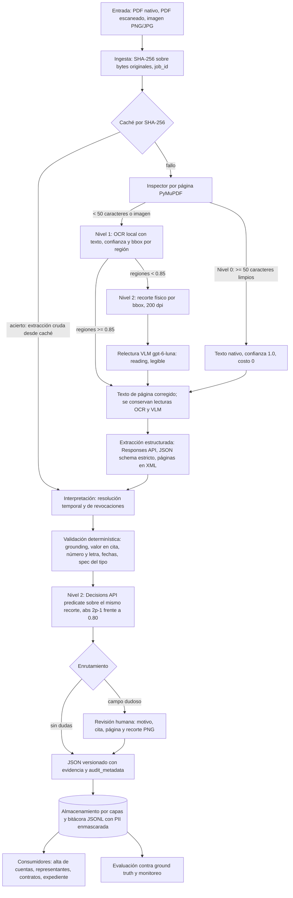

# Arquitectura y diseño

Documento principal de arquitectura del pipeline de extracción de actas constitutivas y sus modificaciones. Reúne el diagrama de alto nivel, los niveles de lectura y escalamiento, los flujos concretos de los tres documentos de prueba, los modos de proveedor, las respuestas de la Parte 1 y un resumen de las Partes 2 a 4. El detalle de evaluación, revisión de código y esquema está en [EVALUACION.md](EVALUACION.md), [CODE_REVIEW.md](CODE_REVIEW.md) y [SCHEMA.md](SCHEMA.md). La exportación de una página de diagrama y una página de decisiones está en [arquitectura.pdf](arquitectura.pdf).

## 1. Propósito y principios

El sistema convierte un documento notarial (PDF nativo, PDF escaneado o imagen) en un registro JSON tipado y versionado, en el que cada valor lleva la página y la cita literal que lo sustentan, una confianza con fuente medible y, cuando corresponde, un motivo explícito de revisión humana.

Principios de diseño:

- **Workflow determinístico con pasos de IA acotados.** El orden de las etapas, los umbrales y la decisión de revisión los fija el código. Cada llamada a un modelo tiene una entrada definida, un esquema de salida estricto y un uso único.
- **Separación de extracción, interpretación y validación.** El modelo extrae hechos con evidencia; el código determinístico interpreta (estado vigente) y valida (evidencia, coherencia, umbrales).
- **El costo y el riesgo se concentran donde hay incertidumbre.** Las páginas nativas no pasan por OCR ni por modelos de visión; la escalación opera sobre regiones, no sobre documentos completos.
- **Abstenerse antes que adivinar.** Ante evidencia insuficiente el valor se conserva y el campo se envía a revisión con su motivo.

## 2. Diagrama de alto nivel

## 3. Niveles de lectura y escalamiento

| Nivel | Cuándo | Qué hace | Confianza | Costo marginal |
|-------|--------|----------|-----------|----------------|
| 0. Texto nativo | Página con 50 o más caracteres alfanuméricos limpios en su capa de texto (PyMuPDF) | Usa el texto del PDF tal cual | 1.0, fuente `native_pdf` | 0 (sin modelo) |
| 1. OCR local con bbox | Página con menos de 50 caracteres limpios, o imagen | Render a 200 dpi; OCR que devuelve texto, confianza y bounding box por región | La del motor, fuente `ocr_engine` | Cómputo local |
| 2. Recorte, relectura VLM y verificación | Región de evidencia con confianza OCR menor a 0.85 | Recorte físico por bbox (con margen de 12 pt, 200 dpi); relectura con `gpt-6-luna` visión con esquema estricto `{reading, legible}`; tras la extracción, pregunta `predicate` de la API Decisions sobre el mismo recorte | `abs(2p - 1)`, fuente `decisions_predicate` | Solo regiones dudosas |

**Por qué el umbral de 0.85 dispara escalamiento.** Una lectura OCR de baja confianza es exactamente donde una cifra puede cambiar sin que el texto resultante parezca anómalo. Casos típicos en escrituras: sellos y firmas encimados sobre montos, copias de copias degradadas, manchas de humedad, páginas inclinadas y textos de máquina de escribir con tipos rotos. Ejemplo: un sello sobre `$800,000.00` puede producir `$300,000.00`. El texto OCR resultante es plausible, la cita existe en el texto OCR (el grounding pasa) y el valor está en su cita; lo que delata el error es la verificación número frente a letra (`OCHOCIENTOS MIL` frente a 300,000) cuando la letra es legible, y la relectura VLM y el predicado de Decisions sobre la imagen. Por eso el texto OCR nunca se trata como prueba.

**Relectura VLM.** Solo se envían los recortes de las regiones dudosas, como imagen base64, a la Responses API con esquema estricto `{reading: string|null, legible: bool}`. El texto de la página se corrige con la lectura VLM, y la evidencia conserva ambas lecturas (OCR y VLM) para auditoría. La extracción estructurada corre sobre el texto corregido.

**Verificación con la API Decisions.** Después de la extracción, el valor final se verifica con una pregunta `predicate` sobre el mismo recorte (por ejemplo, "el monto del capital social en la página 2 es igual a $250,000.00 MXN"), con el texto OCR marcado como no confiable. La probabilidad `p` se mapea a `abs(2p - 1)`: un "sí" o un "no" confiados son resultados de alta confianza; un valor cercano a 0.5 significa que la imagen no permite decidir. Por debajo de 0.80 el campo va a revisión. Se agregan además preguntas de tipo `score` para dos señales de documento: `OCR_LEGIBILITY_SCORE` (legibilidad de la página o región) y `PROMPT_INJECTION_RISK_SCORE` (riesgo de que el texto intente instruir al modelo); sus umbrales son configurables y deben calibrarse con datos etiquetados.

**Condiciones de revisión en el Nivel 2.** Confianza calibrada de Decisions menor a 0.80; la relectura VLM declara la región ilegible; o las lecturas OCR y VLM discrepan y Decisions no confirma el valor con confianza alta.

**Artefacto para el revisor.** El recorte de cada región escalada se guarda como `outputs/crops/{acta_id}_p{page}_{field}_bbox.png`. El revisor ve el recorte, la cita, la página, ambas lecturas y el motivo, y decide sobre el campo, no sobre el documento completo.

## 4. Por qué la API Decisions y no una confianza verbalizada

- **Primitiva específica.** El endpoint `POST /v1/decisions` (`client.decisions.create`, modelo `gpt-6-luna`) devuelve por pregunta una `probability` (`predicate`) o un `score` con `confidence` (`score`, `choice`) de forma directa. No hay que pedirle a un modelo generativo que escriba un número ni interpretar texto libre.
- **Confianza verbalizada descartada.** Un `"confidence": 0.97` escrito por un modelo generativo dentro de su respuesta es texto generado, no una probabilidad, y no se usa para ninguna decisión del pipeline (detalle en [EVALUACION.md](EVALUACION.md), sección 6). El valor `llm_logprobs` existe en el enum `ConfidenceSource` por compatibilidad con la especificación, pero el pipeline no lo produce.
- **Costo.** Facturación solo por tokens de entrada, USD 0.10 por millón, sin tokens de salida facturados. Medido: 867 tokens de entrada por verificación del Acta B, unos USD 0.00009; latencia observada de 159 a 680 ms en nueve llamadas.
- **Sin modelos de razonamiento extendido.** No se usan modelos de la serie o para extracción ni verificación: añaden latencia y costo y la tarea (leer y verificar un valor acotado) no lo requiere.
- **La probabilidad tampoco se da por calibrada.** El umbral de 0.80 es un valor inicial; antes de producción debe calibrarse con ejemplos etiquetados según el costo de falsos positivos y falsos negativos.

## 5. Flujos concretos de los documentos de prueba

### Acta A: nativo limpio

Dos páginas con capa de texto; ambas en Nivel 0, confianza 1.0. Sin OCR, sin VLM, sin Decisions, sin revisión. La extracción produce los ocho campos con evidencia en páginas 1 y 2; el grounding verifica todas las citas. Resultado: calificación 1.000 tanto en la ejecución determinística como en la ejecución en vivo (5,087 tokens de entrada, 5,101 de salida, 0 fallas de grounding en 20 evidencias).

### Acta B: página escaneada con sello sobre el capital

Página 1 en Nivel 0. Página 2 es una imagen (0 caracteres limpios) y pasa a Nivel 1. La región de la cláusula de capital (bbox `[72.0, 410.0, 520.0, 455.0]`) tiene confianza OCR 0.72, menor a 0.85, y escala a Nivel 2.

- **Ejecución determinística (caché preverificada):** `p = 0.78`, confianza calibrada `abs(2 x 0.78 - 1) = 0.56`, menor a 0.80. `capital_social_actual` se conserva (250,000.00 MXN) y se envía a revisión con el motivo `Low OCR confidence (0.72) and Decisions predicate confidence (0.56 < 0.80) due to overlapping notary seal on page 2 bbox [72.0, 410.0, 520.0, 455.0].`
- **Ejecución en vivo medida:** Decisions sobre el recorte con el texto OCR devolvió `p = 0.35`, confianza calibrada 0.30, menor a 0.80; mismo resultado de enrutamiento. Sin texto OCR: `p = 0.40` (0.20). Solo texto OCR sin imagen: `p = 0.99` (0.98), lo que demuestra que el texto OCR por sí solo induciría una falsa certeza. Con una versión anterior del sello semitransparente (monto legible): `p = 0.72` con texto OCR y `p = 0.90` solo imagen.

El resultado correcto no es omitir el valor ni aceptarlo: es extraerlo, explicar por qué no es verificable y entregarlo al revisor con el recorte.

### Acta C: constitución 2019 y asamblea 2024

Cuatro páginas nativas. La extracción entrega el historial: constitución (2019-05-10, escritura 30,100, capital 100,000.00), aumento de capital (2024-08-20, escritura 58,400, capital 1,000,000.00), revocación de `SR. JUAN C. PEREZ LOPEZ` y otorgamiento de poderes a `ING. ALEJANDRO GÓMEZ RUIZ`.

- **Capital vigente:** el del acto notarial más reciente, 1,000,000.00, con `fecha_acto_vigente` 2024-08-20 y `escritura_origen` 58,400.
- **Revocación:** ambos nombres se normalizan (mayúsculas, sin acentos, sin títulos `LIC.` y `SR.`): `JUAN CARLOS PEREZ LOPEZ` frente a `JUAN C PEREZ LOPEZ`. Regla de expansión de iniciales: la inicial `C` se acepta como `CARLOS` porque el primer nombre (`JUAN`) y los apellidos (`PEREZ LOPEZ`) coinciden. La similitud `max(token_sort_ratio, 0.95 x token_set_ratio)` da 89.41, mayor o igual a 85, y la guarda de apellidos y primer nombre se cumple. Se registra `[REVOKED]` con el puntaje.
- **Evidencias:** la persona y sus poderes salen de las listas vigentes. El evento de revocación conserva su propia evidencia (página 3) y, en `revoked_appointment_evidence`, la del nombramiento original (página 2: `Se nombra como ADMINISTRADOR UNICO al LIC. JUAN CARLOS PÉREZ LÓPEZ`), con `matched_canonical_entity` y `fuzzy_match_score`.
- Representantes vigentes: `MARIA ELENA TORRES VEGA` e `ING. ALEJANDRO GÓMEZ RUIZ`.

Un casi homónimo (por ejemplo `JUAN CARLOS PEREZ LOZANO`, similitud cercana a 89) no se revoca: no pasa la guarda de apellidos y el campo va a revisión. Una similitud entre 75 y 85 tampoco decide en silencio.

## 6. Modos de proveedor

| Modo | Extracción y relectura VLM | Verificación Decisions | Uso |
|------|---------------------------|------------------------|-----|
| OpenAI Cloud en vivo | Responses API, `gpt-6-luna` | API Decisions, `gpt-6-luna` | Requiere `OPENAI_API_KEY`; solo en fallos de caché |
| Base URL compatible con OpenAI | Servidor on-prem en OpenShift (vLLM o TGI con modelos como Qwen2.5-VL o Llama) mediante `OPENAI_BASE_URL` | Requiere OpenAI Cloud: la API Decisions no tiene equivalente on-prem hoy | Datos que no deben salir de la infraestructura propia; el nivel de verificación queda en la nube o se sustituye por revisión humana |
| Sin conexión | Caché determinística preverificada por SHA-256 | Caché determinística | Demostración y pruebas reproducibles sin credenciales |

El orquestador depende solo de las interfaces (`BaseLLMProvider`, `BaseOCRProvider`, `BaseVerifierProvider`, `BaseStorageRepository`), por lo que el modo se elige por configuración sin cambiar el pipeline. Compensación honesta: un modelo on-prem reduce la exposición de datos pero exige operar GPU, medir su calidad con la misma evaluación y aceptar que la verificación por predicado sigue dependiendo del servicio en la nube.

## 7. Decisiones de arquitectura (Parte 1)

**1. ¿Cómo distinguir un PDF nativo de uno escaneado y cómo cambia el pipeline?** Por página, no por documento: PyMuPDF extrae la capa de texto y se cuentan caracteres alfanuméricos limpios; con 50 o más la página es nativa (Nivel 0), con menos se renderiza a 200 dpi y pasa a OCR (Nivel 1). Un documento puede ser híbrido (Acta B). Una imagen PNG/JPG se trata como página escaneada. Solo cambia la fuente del texto, su confianza y la posible escalación; extracción, interpretación y validación son las mismas.

**2. ¿Cuándo extracción nativa, OCR, modelo multimodal o LLM de texto?** Nativa siempre que haya capa de texto: exacta, gratuita y determinística. OCR local para páginas sin texto: barato y con confianza y bbox por región. Modelo multimodal solo sobre recortes de regiones con confianza OCR menor a 0.85 (relectura VLM con esquema `{reading, legible}`), nunca sobre el documento completo, para acotar costo y superficie de alucinación. LLM de texto para la extracción a esquema estricto sobre el texto ya corregido. La API Decisions como verificador independiente del valor final sobre el mismo recorte.

**3. ¿Qué información conservar para auditoría y reutilización?** El original direccionado por SHA-256; el texto por página con su fuente; las regiones OCR con bbox y confianza; las lecturas OCR y VLM; los recortes PNG de regiones escaladas; la extracción cruda previa a la resolución (se cachea para que la lógica determinística se re-ejecute siempre); el JSON final con `page_number`, `source_quote`, `confidence_source`, `bounding_box` y motivo de revisión por campo; `audit_metadata` (`schema_version`, `model_version`); `prompt_sha256` en la entrada de caché; y la bitácora JSONL con PII enmascarada.

**4. ¿Qué es síncrono y qué asíncrono?** Síncrono: recepción, hash, consulta de caché y respuesta (HTTP 202 con `job_id`, o el resultado si ya existe). Asíncrono: OCR, relectura VLM, extracción, verificación y revisión humana, en cola con reintentos acotados y cola de mensajes muertos (DLQ). El prototipo ejecuta por lotes desde la CLI; el `Deployment` de OpenShift modela la forma de worker con HPA.

**5. ¿Dónde reglas determinísticas, ML o GenAI?** Reglas para todo lo verificable: enrutamiento de páginas, grounding, valor en cita, número frente a letra, coherencia de fechas, resolución temporal, revocaciones (RapidFuzz >= 85 con guarda de apellidos), umbrales y enrutamiento. ML clásico para OCR y, a futuro, clasificación documental. GenAI solo para lenguaje o imagen no estructurados: extracción a esquema, relectura visual de regiones dudosas y verificación por predicado o score.

**6. ¿Agente, workflow determinístico o combinación?** Workflow determinístico con pasos de IA acotados. El proceso es regulado y la estructura del documento es conocida; un agente autónomo añadiría variabilidad entre ejecuciones y una superficie de inyección difícil de auditar, sin beneficio. Los modelos se usan como funciones con entrada y salida tipadas dentro de un flujo fijo.

**7. ¿Qué condiciones envían un caso a revisión humana?** Confianza calibrada de Decisions menor a 0.80; región declarada ilegible por la relectura VLM; discrepancia entre OCR y VLM sin confirmación alta de Decisions; falla de grounding (confianza topada en 0.40); valor ausente en su propia cita; monto en número distinto del monto en letra; incoherencia temporal (evento anterior a la constitución, revocación anterior al nombramiento); revocación ambigua (similitud entre 75 y 85, o apellidos distintos); campo requerido ausente; verificador no disponible o con rechazo; y riesgo de inyección o legibilidad fuera de umbral según las preguntas `score`.

## 8. Diseño transversal

**Imágenes.** Un PNG o JPG se envuelve como documento de una página escaneada. El SHA-256 se calcula sobre los bytes originales de la imagen, no sobre el PDF derivado, para que la idempotencia no dependa de la conversión.

**Reutilización por varios consumidores.** Se extrae una sola vez por documento y se cachea por SHA-256. Alta de cuentas, validación de representantes legales, firma y revisión de contratos y actualización de expediente leen el mismo JSON versionado; cada consumidor aplica su política sobre `status`, evidencia y `requires_human_review` (por ejemplo, firma de contratos puede exigir que `representantes_legales` y `poderes` no tengan revisión pendiente, mientras que actualización de expediente puede aceptar campos en revisión marcados como tales).

**Evolución a otros tipos documentales.** Poderes notariales, identificaciones, comprobantes de domicilio, estados de cuenta y contratos se agregan registrando un `DocumentTypeSpec` en `DocumentRegistry` (campos requeridos y aplicables, si aplica resolución temporal, constructor de prompt) y su modelo de salida. El orquestador, los validadores genéricos (grounding, valor en cita, umbrales) y la evaluación no cambian. La clasificación del tipo documental se discute en [CODE_REVIEW.md](CODE_REVIEW.md), pregunta d.

**Fallos, reintentos e idempotencia.** Reintentos con `tenacity` (tres intentos, backoff exponencial) solo para errores transitorios (conexión, timeout, rate limit, error de servidor); el SDK se configura con `max_retries=0` y timeout de 60 s para no duplicar la política. Un rechazo, una salida fuera de esquema o un verificador no disponible no se reintentan: el campo va a revisión con motivo explícito. Un resultado en vivo con fallas de grounding no se guarda en caché. Un documento con página escaneada sin motor OCR disponible falla con `[ERROR]` explícito; ninguna página se omite en silencio.

**Versionado.** `schema_version` (versionado semántico) y `model_version` en `audit_metadata`; `prompt_sha256` en cada entrada de caché en vivo. Una entrada cuyo `prompt_sha256` no coincide con el prompt actual se trata como fallo de caché. Las entradas preverificadas nunca se sobrescriben.

**Privacidad y observabilidad.** `PIIRedactionFilter` enmascara RFC, CURP y correo en consola y en la bitácora JSONL. Cada registro lleva `timestamp`, `level`, `job_id`, `doc_sha256`, `stage`, `event`, `duration_ms` y `details`. La extracción vía Responses API usa `store=False`. Los nombres de personas sí aparecen en la bitácora (limitación conocida). El contenedor corre sin privilegios bajo la SCC `restricted-v2` de OpenShift.

**Escalabilidad y costo, sin sobrediseño.** Workers sin estado detrás de una cola, con HPA. La caché por SHA-256 elimina el reprocesamiento de duplicados. El costo variable se concentra en la extracción (medido: 4,656 a 5,087 tokens de entrada y 3,323 a 5,101 de salida por acta) y en las páginas escaneadas; Decisions cuesta unos USD 0.00009 por verificación medida. No se introducen componentes (orquestador de agentes, base vectorial, modelo propio) que el problema actual no requiere.

## 9. Parte 2: prototipo

Implementación en `src/`, ejecutable con `uv run actas-cli demo` (generación de los tres documentos, procesamiento y evaluación). El esquema esperado se extiende con evidencia por campo, estado, historial de actos y metadatos de auditoría; cada extensión y cambio de nombre se justifica en [SCHEMA.md](SCHEMA.md). El ground truth legible está en [GROUND_TRUTH.md](GROUND_TRUTH.md) y las salidas en [results/](../results/).

El comando `actas-cli test-decisions [--live]` ejecuta cuatro casos de verificación con la API Decisions (predicado sobre texto limpio, predicado sobre el recorte sellado del Acta B con `abs(2p - 1)`, predicado de contradicción sobre el representante revocado del Acta C y score de riesgo de inyección) y escribe `outputs/decisions_verification_report.json`.

## 10. Parte 3: evaluación

Métricas por tipo de campo con pesos (montos y representantes 0.20; el resto 0.10), Evidence Hit Rate, coincidencia del enrutamiento a revisión y penalización de falsos positivos críticos (representante revocado listado como vigente). Resultado determinístico: 1.000 en los tres documentos, 100% de Evidence Hit Rate, enrutamiento a revisión correcto. Resultados en vivo, asimetría de errores, criterios de abstención, datos necesarios para producción y la interpretación de `confidence = 0.97`: [EVALUACION.md](EVALUACION.md).

## 11. Parte 4: revisión de código

Revisión priorizada del fragmento `process_document`, con cada corrección vinculada al módulo del repositorio que la implementa, y respuestas sobre inyección de instrucciones, escala a 2 millones de documentos al mes, impacto de 80% de PDF nativos y clasificación de 50,000 documentos históricos: [CODE_REVIEW.md](CODE_REVIEW.md).

## 12. Evidencia medida y diseño

Las cifras de este documento provienen de ejecuciones reales: la ejecución determinística (`actas-cli demo`) y las mediciones en vivo del 2026-10-18 (extracción de Actas A y B; verificación Decisions del Acta B). La relectura VLM, las preguntas `score`, los recortes en `outputs/crops/`, el comando `test-decisions` y el modo con `OPENAI_BASE_URL` forman parte del diseño descrito; este documento no reporta métricas de esas etapas.
