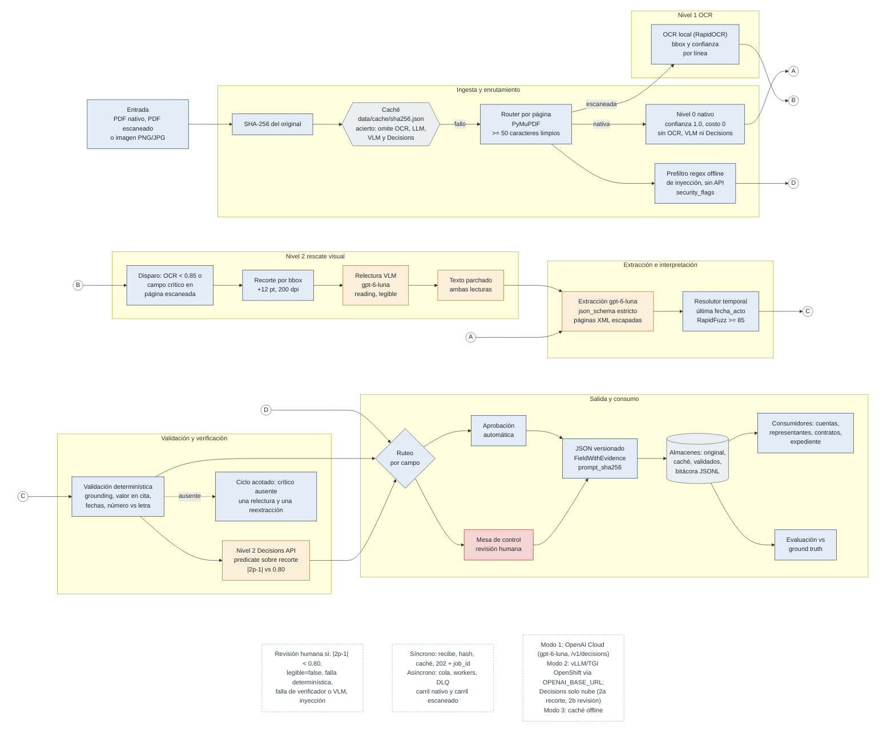

# Arquitectura y diseño

Documento principal de arquitectura del pipeline de extracción de actas constitutivas y sus modificaciones. Reúne el diagrama de alto nivel, los niveles de lectura y escalamiento, los flujos concretos de los tres documentos de prueba, los modos de proveedor, las respuestas de la Parte 1 y un resumen de las Partes 2 a 4. El detalle de evaluación, revisión de código y esquema está en [EVALUACION.md](EVALUACION.md), [CODE_REVIEW.md](CODE_REVIEW.md) y [SCHEMA.md](SCHEMA.md). La exportación de una página de diagrama y una página de decisiones está en [arquitectura.pdf](arquitectura.pdf).

## 1. Propósito y principios

El sistema convierte un documento notarial (PDF nativo, PDF escaneado o imagen) en un registro JSON tipado y versionado, en el que cada valor lleva la página y la cita literal que lo sustentan, una confianza con fuente medible y, cuando corresponde, un motivo explícito de revisión humana.

Principios de diseño:

- **Workflow determinístico con pasos de IA acotados.** El orden de las etapas, los umbrales y la decisión de revisión los fija el código. Cada llamada a un modelo tiene una entrada definida, un esquema de salida estricto y un uso único.
- **Separación de extracción, interpretación y validación.** El modelo extrae hechos con evidencia; el código determinístico interpreta (estado vigente) y valida (evidencia, coherencia, umbrales).
- **El costo y el riesgo se concentran donde hay incertidumbre.** Las páginas nativas no pasan por OCR ni por modelos de visión; la escalación opera sobre regiones, no sobre documentos completos.
- **Abstenerse antes que adivinar.** Ante evidencia insuficiente el valor se conserva y el campo se envía a revisión con su motivo.

## 2. Diagrama de alto nivel

Versión exportable: [arquitectura.pdf](arquitectura.pdf) (página 1: diagrama; página 2: decisiones). Fuente Mermaid en [architecture.mmd](architecture.mmd); imagen en [architecture_diagram.png](architecture_diagram.png).

Orden de etapas en el pipeline: ingesta y hash SHA-256, consulta de caché, inspección por página (Nivel 0 nativo o escaneada), prefiltro de inyección por expresiones regulares sin conexión en toda página, OCR de Nivel 1 en páginas escaneadas, disparo y relectura VLM sobre recortes (Nivel 2), extracción, interpretación temporal, validación determinística (con a lo sumo una relectura y una reextracción para un campo crítico ausente), verificación Decisions por predicado sobre el recorte (único uso de Decisions), ruteo por campo hacia aprobación automática o Mesa de control, y almacenamiento.

## 3. Niveles de lectura y escalamiento

| Nivel | Cuándo | Qué hace | Confianza | Costo marginal |
|-------|--------|----------|-----------|----------------|
| 0. Texto nativo | Página con 50 o más caracteres alfanuméricos limpios en su capa de texto (PyMuPDF) | Usa el texto del PDF tal cual | 1.0, fuente `native_pdf` | 0 (sin modelo) |
| 1. OCR local con bbox | Página con menos de 50 caracteres limpios, o imagen | Render a 200 dpi; OCR que devuelve texto, confianza y bounding box por región | La del motor, fuente `ocr_engine` | Cómputo local |
| 2. Recorte, relectura VLM y verificación | Página escaneada o imagen: región de evidencia con confianza OCR menor a 0.85, o cualquier campo crítico (`fecha_constitucion`, `numero_escritura`, `notario`, `capital_social_actual`, `representantes_legales`, `poderes`), siempre | Recorte físico por bbox (con margen de 12 pt, 200 dpi); relectura con `gpt-6-luna` visión con esquema estricto `{reading, legible}`; tras la extracción, pregunta `predicate` de la API Decisions sobre el mismo recorte | `abs(2p - 1)`, fuente `decisions_predicate` | Solo regiones dudosas |

**Por qué el umbral de 0.85 dispara escalamiento.** Una lectura OCR de baja confianza es exactamente donde una cifra puede cambiar sin que el texto resultante parezca anómalo. Casos típicos en escrituras: sellos y firmas encimados sobre montos, copias de copias degradadas, manchas de humedad, páginas inclinadas y textos de máquina de escribir con tipos rotos. Ejemplo: un sello sobre `$800,000.00` puede producir `$300,000.00`. El texto OCR resultante es plausible, la cita existe en el texto OCR (el grounding pasa) y el valor está en su cita; lo que delata el error es la verificación número frente a letra (`OCHOCIENTOS MIL` frente a 300,000) cuando la letra es legible, y la relectura VLM y el predicado de Decisions sobre la imagen. Por eso el texto OCR nunca se trata como prueba.

**Por qué los campos críticos se releen siempre.** La confianza del Nivel 1 no detecta omisiones. Con RapidOCR real, la página sellada del Acta B se lee con confianza mayor o igual a 0.90 y se omite en silencio `$250,000.00 (DOSCIENTOS CINCUENTA`; el umbral de 0.85 por sí solo nunca se dispara. Por eso, en páginas escaneadas, todo campo crítico pasa por recorte, relectura VLM y predicado de Decisions, sin importar la confianza OCR. Las páginas nativas nunca usan VLM ni Decisions.

**Relectura VLM.** Solo se envían los recortes de las regiones dudosas, como imagen base64, a la Responses API con esquema estricto `{reading: string|null, legible: bool}`. El texto de la página se corrige con la lectura VLM conservando ambas lecturas (OCR y VLM), también en la evidencia, para auditoría. La extracción estructurada corre sobre el texto corregido. Flujo: recorte por bbox (+12 pt, 200 dpi, `outputs/crops/`), relectura `gpt-6-luna` `{reading, legible}`, texto corregido, extracción y predicado de Decisions por campo.

**Verificación con la API Decisions.** Después de la extracción, el valor final se verifica con una pregunta `predicate` sobre el mismo recorte (por ejemplo, "el monto del capital social en la página 2 es igual a $250,000.00 MXN"), con el texto OCR marcado como no confiable. La probabilidad `p` se mapea a `abs(2p - 1)`: un "sí" o un "no" confiados son resultados de alta confianza; un valor cercano a 0.5 significa que la imagen no permite decidir. Por debajo de 0.80 el campo va a revisión. Este predicado es el único uso de Decisions en el pipeline: no hay puntajes de Decisions por página.

**Ruta acotada.** Si un campo crítico requerido de una página escaneada queda `no_encontrado`, se hace una relectura VLM y a lo sumo una reextracción. Lo que siga sin resolverse va a revisión con un motivo factual.

**Inyección de instrucciones dentro del pipeline.** Se defiende con fronteras XML de página (`<page page_number="N">`) con escape, roles developer/user, esquema estricto, validación determinística y un prefiltro de expresiones regulares sin conexión (`src/pipeline/injection_guard.py`). Una coincidencia fija `audit_metadata.security_flags = ["prompt_injection_suspected"]`, fuerza revisión humana global, impide la aprobación automática de los campos de esa página y queda en la bitácora de auditoría. No se hace ninguna llamada a una API para detectar inyección; el texto se sigue extrayendo como dato no confiable. El comando `actas-cli test-decisions` conserva un caso de `score` de riesgo de inyección como verificación independiente de la API Decisions, que no forma parte del procesamiento.

**Condiciones de revisión por campo.** Solo hechos sobre el valor del propio campo: su predicado con `abs(2p - 1)` menor a 0.80; su propia región con `legible = false`; una falla determinística (número frente a letra del capital, valor en cita, grounding); una falla del verificador o de la relectura VLM; o una bandera de inyección. Un `legible = false` de una relectura de página completa nunca marca un campo por sí solo. Una corrección confirmada con confianza mayor o igual a 0.80 se acepta.

**Artefacto para el revisor.** El recorte de cada región escalada se guarda como `outputs/crops/{acta_id}_p{page}_{field}_bbox.png`. El revisor ve el recorte, la cita, la página, ambas lecturas y el motivo, y decide sobre el campo, no sobre el documento completo.

## 4. Por qué la API Decisions y no una confianza verbalizada

- **Primitiva específica.** El endpoint `POST /v1/decisions` (`client.decisions.create`, modelo `gpt-6-luna`) devuelve por pregunta una `probability` (`predicate`) o un `score` con `confidence` (`score`, `choice`) de forma directa. No hay que pedirle a un modelo generativo que escriba un número ni interpretar texto libre.
- **Confianza verbalizada descartada.** Un `"confidence": 0.97` escrito por un modelo generativo dentro de su respuesta es texto generado, no una probabilidad, y no se usa para ninguna decisión del pipeline (detalle en [EVALUACION.md](EVALUACION.md), sección 6). El valor `llm_logprobs` existe en el enum `ConfidenceSource` por compatibilidad con la especificación, pero el pipeline no lo produce.
- **Costo.** Facturación solo por tokens de entrada, USD 0.10 por millón, sin tokens de salida facturados. Medido: 867 tokens de entrada por verificación del Acta B, unos USD 0.00009; latencia observada de 159 a 680 ms en nueve llamadas. Los cuatro casos de `test-decisions --live` usaron 1,891 tokens de entrada en total (unos USD 0.0002).
- **Sin modelos de razonamiento extendido.** No se usan modelos de la serie o para extracción ni verificación: añaden latencia y costo y la tarea (leer y verificar un valor acotado) no lo requiere.
- **La probabilidad tampoco se da por calibrada.** El umbral de 0.80 es un valor inicial; antes de producción debe calibrarse con ejemplos etiquetados según el costo de falsos positivos y falsos negativos.

## 5. Flujos concretos de los documentos de prueba

### Acta A: nativo limpio

Dos páginas con capa de texto; ambas en Nivel 0, confianza 1.0. Sin OCR y sin relectura VLM. Sin predicado de Decisions y sin revisión. La extracción produce los ocho campos con evidencia en páginas 1 y 2; el grounding verifica todas las citas. Resultado: calificación 1.000 tanto en la ejecución determinística como en la ejecución en vivo (5,087 tokens de entrada, 5,101 de salida, 0 fallas de grounding en 20 evidencias).

### Acta B: página escaneada con sello sobre el capital

Página 1 en Nivel 0. Página 2 es una imagen (0 caracteres limpios) y pasa a Nivel 1. La región de la cláusula de capital (bbox `[72.0, 410.0, 520.0, 455.0]`) tiene confianza OCR 0.72, menor a 0.85 (y además es un campo crítico en una página escaneada), por lo que se recorta, se relee con el VLM y escala al predicado de Decisions (Nivel 2). En la caché determinística la relectura coincide con el texto OCR, de modo que se conserva el motivo de la especificación.

- **Ejecución determinística (caché preverificada):** `p = 0.78`, confianza calibrada `abs(2 x 0.78 - 1) = 0.56`, menor a 0.80. `capital_social_actual` se conserva (250,000.00 MXN) y se envía a revisión con el motivo `Low OCR confidence (0.72) and Decisions predicate confidence (0.56 < 0.80) due to overlapping notary seal on page 2 bbox [72.0, 410.0, 520.0, 455.0].`
- **Ejecución en vivo medida:** Decisions sobre el recorte con el texto OCR devolvió `p = 0.35`, confianza calibrada 0.30, menor a 0.80; mismo resultado de enrutamiento. Sin texto OCR: `p = 0.40` (0.20). Solo texto OCR sin imagen: `p = 0.99` (0.98), lo que demuestra que el texto OCR por sí solo induciría una falsa certeza. Con una versión anterior del sello semitransparente (monto legible): `p = 0.72` con texto OCR y `p = 0.90` solo imagen.

- **Relectura VLM en vivo medida:** `gpt-6-luna` sobre el recorte sellado devolvió `{"reading": "QUINTA.- El capital social es de $ MIL PESOS 00/100 M.N.).", "legible": false}`; sobre un recorte limpio del Acta A leyó el texto exacto con `legible = true`.
- **`test-decisions --live` (2026-10-19):** predicado sobre texto limpio `p = 1.00` (CONFIRMED); recorte sellado del Acta B `p = 0.48`, `abs(2p - 1) = 0.04` (REVIEW); predicado del representante revocado del Acta C `p = 0.00` (REJECTED); riesgo de inyección normalizado 0.997 (FLAGGED, con coincidencias de regex `ignore_previous_instructions`, `force_approval` y `skip_human_review`).
- **Ejecución exploratoria completa en vivo con RapidOCR real (diseño anterior, con un puntaje de legibilidad de página ya retirado):** la primera extracción dejó capital y `poderes` como `no_encontrado` (RapidOCR omitió en silencio el monto bajo el sello con confianza alta); la relectura VLM de página completa devolvió `legible = false` con la transcripción visible; una reextracción obtuvo capital 250,000.00 con `monto_en_letra` `[ilegible] MIL PESOS 00/100 M.N.`; Decisions sobre el recorte grueso de página completa dio `p = 0.98` (frente a 0.48 con el recorte ajustado); el capital se envió a revisión por la discrepancia número frente a letra y por `legible = false`. Limitación: la fusión a página completa entrega al predicado un recorte grueso; la revisión provino de las verificaciones determinísticas, no del predicado.

El resultado correcto no es omitir el valor ni aceptarlo: es extraerlo, explicar por qué no es verificable y entregarlo al revisor con el recorte.

### Acta C: constitución 2019 y asamblea 2024

Cuatro páginas nativas, sin VLM ni Decisions. La extracción entrega el historial: constitución (2019-05-10, escritura 30,100, capital 100,000.00), aumento de capital (2024-08-20, escritura 58,400, capital 1,000,000.00), revocación de `SR. JUAN C. PEREZ LOPEZ` y otorgamiento de poderes a `ING. ALEJANDRO GÓMEZ RUIZ`.

- **Capital vigente:** el del acto notarial más reciente, 1,000,000.00, con `fecha_acto_vigente` 2024-08-20 y `escritura_origen` 58,400.
- **Revocación:** ambos nombres se normalizan (mayúsculas, sin acentos, sin títulos `LIC.` y `SR.`): `JUAN CARLOS PEREZ LOPEZ` frente a `JUAN C PEREZ LOPEZ`. Regla de expansión de iniciales: la inicial `C` se acepta como `CARLOS` porque el primer nombre (`JUAN`) y los apellidos (`PEREZ LOPEZ`) coinciden. La similitud `max(token_sort_ratio, 0.95 x token_set_ratio)` da 89.41, mayor o igual a 85, y la guarda de apellidos y primer nombre se cumple. Se registra `[REVOKED]` con el puntaje.
- **Evidencias:** la persona y sus poderes salen de las listas vigentes. El evento de revocación conserva su propia evidencia (página 3) y, en `revoked_appointment_evidence`, la del nombramiento original (página 2: `Se nombra como ADMINISTRADOR UNICO al LIC. JUAN CARLOS PÉREZ LÓPEZ`), con `matched_canonical_entity` y `fuzzy_match_score`.
- Representantes vigentes: `MARIA ELENA TORRES VEGA` e `ING. ALEJANDRO GÓMEZ RUIZ`.

Un casi homónimo (por ejemplo `JUAN CARLOS PEREZ LOZANO`, similitud cercana a 89) no se revoca: no pasa la guarda de apellidos y el campo va a revisión. Una similitud entre 75 y 85 tampoco decide en silencio.

## 6. Modos de proveedor

**Modo 1 (por defecto): todo en OpenAI Cloud con `OPENAI_API_KEY`.** Extracción con `gpt-6-luna` (Responses API, esquema estricto), relectura VLM con `gpt-6-luna` y Decisions `/v1/decisions` con `gpt-6-luna` (solo el predicado por campo, sobre el recorte).

**Modo 2 (alternativa si el banco no puede enviar documentos a OpenAI).** La extracción y la relectura VLM se apuntan a un servidor on-prem compatible con OpenAI (vLLM o TGI sobre GPU de Red Hat OpenShift con modelos multimodales abiertos como Qwen2.5-VL o Llama) mediante `OPENAI_BASE_URL`, sin cambios de código. Decisions queda siempre solo en la nube. Como `/v1/decisions` existe solo en OpenAI Cloud, hay dos variantes:

- **2a:** enviar a Decisions únicamente el recorte del campo (por ejemplo, la franja del capital), nunca la página.
- **2b:** no usar Decisions; esos campos pasan directamente a revisión humana (verificador no disponible lleva a revisión, ya implementado).

Solo la aceptación de la URL base está implementada; el resto del Modo 2 está documentado, no ejercitado.

**Modo 3: caché determinística preverificada fuera de línea** (por defecto cuando no hay llave): `actas-cli demo`, pruebas y CI.

No se usan modelos de razonamiento de la serie o (latencia y costo, y no hacen falta).

El orquestador depende solo de las interfaces (`BaseLLMProvider`, `BaseOCRProvider`, `BaseVerifierProvider`, `BaseStorageRepository`), por lo que el modo se elige por configuración sin cambiar el pipeline. Compensación honesta: un modelo on-prem reduce la exposición de datos pero exige operar GPU, medir su calidad con la misma evaluación y aceptar que la verificación por predicado sigue dependiendo del servicio en la nube (2a) o se sustituye por revisión humana (2b).

## 7. Decisiones de arquitectura (Parte 1)

**1. ¿Cómo distinguir un PDF nativo de uno escaneado y cómo cambia el pipeline?** Por página, no por documento: PyMuPDF extrae la capa de texto y se cuentan caracteres alfanuméricos limpios; con 50 o más la página es nativa (Nivel 0), con menos se renderiza a 200 dpi y pasa a OCR (Nivel 1). Un documento puede ser híbrido (Acta B). Una imagen PNG/JPG se trata como página escaneada. Solo cambia la fuente del texto, su confianza y la posible escalación; extracción, interpretación y validación son las mismas.

**2. ¿Cuándo extracción nativa, OCR, modelo multimodal o LLM de texto?** Nativa siempre que haya capa de texto: exacta, gratuita y determinística. OCR local para páginas sin texto: barato y con confianza y bbox por región. Modelo multimodal solo sobre recortes de regiones con confianza OCR menor a 0.85, o de campos críticos en páginas escaneadas, siempre (relectura VLM con esquema `{reading, legible}`); la imagen de página completa solo se usa, de forma acotada, en la relectura de un campo crítico requerido que quedó `no_encontrado`. Las páginas nativas nunca usan VLM. Esto acota costo y superficie de alucinación y cubre las omisiones que la confianza del OCR no detecta. LLM de texto para la extracción a esquema estricto sobre el texto ya corregido. La API Decisions como verificador independiente del valor final sobre el mismo recorte.

**3. ¿Qué información conservar para auditoría y reutilización?** El original direccionado por SHA-256; el texto por página con su fuente; las regiones OCR con bbox y confianza; las lecturas OCR y VLM; los recortes PNG de regiones escaladas; la extracción cruda previa a la resolución (se cachea para que la lógica determinística se re-ejecute siempre); el JSON final con `page_number`, `source_quote`, `confidence_source`, `bounding_box` y motivo de revisión por campo; `audit_metadata` (`schema_version`, `model_version`); `prompt_sha256` en la entrada de caché; y la bitácora JSONL con PII enmascarada.

**4. ¿Qué es síncrono y qué asíncrono?** Síncrono: recepción, hash, consulta de caché y respuesta (HTTP 202 con `job_id`, o el resultado si ya existe). Asíncrono: OCR, relectura VLM, extracción, verificación y revisión humana, en cola con reintentos acotados y cola de mensajes muertos (DLQ). El prototipo ejecuta por lotes desde la CLI; el `Deployment` de OpenShift modela la forma de worker con HPA.

**5. ¿Dónde reglas determinísticas, ML o GenAI?** Reglas para todo lo verificable: enrutamiento de páginas, grounding, valor en cita, número frente a letra, coherencia de fechas, resolución temporal, revocaciones (RapidFuzz >= 85 con guarda de apellidos), umbrales y enrutamiento. ML clásico para OCR y, a futuro, clasificación documental. GenAI solo para lenguaje o imagen no estructurados: extracción a esquema, relectura visual de regiones dudosas y verificación por predicado de cada campo (único uso de Decisions en el pipeline).

**6. ¿Agente, workflow determinístico o combinación?** Workflow determinístico con pasos de IA acotados. El proceso es regulado y la estructura del documento es conocida; un agente autónomo añadiría variabilidad entre ejecuciones y una superficie de inyección difícil de auditar, sin beneficio. Los modelos se usan como funciones con entrada y salida tipadas dentro de un flujo fijo.

**7. ¿Qué condiciones envían un caso a revisión humana?** Por campo, solo hechos sobre su propio valor: predicado de Decisions con confianza calibrada menor a 0.80; su región declarada ilegible por la relectura VLM (`legible = false`) o relectura fallida; falla de grounding (confianza topada en 0.40); valor ausente en su propia cita; monto en número distinto del monto en letra; verificador no disponible o con rechazo. Además: incoherencia temporal (evento anterior a la constitución, revocación anterior al nombramiento); revocación ambigua (similitud entre 75 y 85, o apellidos distintos); campo requerido ausente o campo crítico que sigue `no_encontrado` tras la relectura acotada y una única reextracción; y una bandera de inyección (prefiltro de regex sin conexión), que fuerza revisión global e impide la aprobación automática de los campos de esa página. Un `legible = false` de una relectura de página completa nunca marca un campo por sí solo.

## 8. Diseño transversal

**Imágenes.** Un PNG o JPG, o un conjunto ordenado de ellos que forma un documento, se envuelve (`src/ingestion/image_loader.py`) en un PDF con una página por imagen (tamaño en píxeles a 200 dpi, orientación EXIF aplicada) y sigue la ruta de página escaneada; la imagen N es la página N. El SHA-256 se calcula sobre los bytes originales de la imagen (para varias, una concatenación con prefijo de longitud en el orden dado), no sobre el PDF derivado, para que la idempotencia no dependa de la conversión. Se procesan con `actas-cli process-file`.

**Reutilización por varios consumidores.** Se extrae una sola vez por documento y se cachea por SHA-256. Alta de cuentas, validación de representantes legales, firma y revisión de contratos y actualización de expediente leen el mismo JSON versionado; cada consumidor aplica su política sobre `status`, evidencia y `requires_human_review` (por ejemplo, firma de contratos puede exigir que `representantes_legales` y `poderes` no tengan revisión pendiente, mientras que actualización de expediente puede aceptar campos en revisión marcados como tales).

**Evolución a otros tipos documentales.** Poderes notariales, identificaciones, comprobantes de domicilio, estados de cuenta y contratos se agregan registrando un `DocumentTypeSpec` en `DocumentRegistry` (campos requeridos y aplicables, si aplica resolución temporal, constructor de prompt) y su modelo de salida. El orquestador, los validadores genéricos (grounding, valor en cita, umbrales) y la evaluación no cambian. La clasificación del tipo documental se discute en [CODE_REVIEW.md](CODE_REVIEW.md), pregunta d.

**Fallos, reintentos e idempotencia.** Reintentos con `tenacity` (tres intentos, backoff exponencial) solo para errores transitorios (conexión, timeout, rate limit, error de servidor); el SDK se configura con `max_retries=0` y timeout de 60 s para no duplicar la política. Un rechazo, una salida fuera de esquema o un verificador no disponible no se reintentan: el campo va a revisión con motivo explícito. Un resultado en vivo con fallas de grounding no se guarda en caché. Un documento con página escaneada sin motor OCR disponible falla con `[ERROR]` explícito; ninguna página se omite en silencio.

**Versionado.** `schema_version` (versionado semántico) y `model_version` en `audit_metadata`; `prompt_sha256` en cada entrada de caché en vivo. Una entrada cuyo `prompt_sha256` no coincide con el prompt actual se trata como fallo de caché. Las entradas preverificadas nunca se sobrescriben.

**Privacidad y observabilidad.** `PIIRedactionFilter` enmascara RFC, CURP y correo en consola y en la bitácora JSONL. Cada registro lleva `timestamp`, `level`, `job_id`, `doc_sha256`, `stage`, `event`, `duration_ms` y `details`. La extracción vía Responses API usa `store=False`. Los nombres de personas sí aparecen en la bitácora (limitación conocida). El contenedor corre sin privilegios bajo la SCC `restricted-v2` de OpenShift.

**Escalabilidad y costo, sin sobrediseño.** Workers sin estado detrás de una cola, con HPA. La caché por SHA-256 elimina el reprocesamiento de duplicados. El costo variable se concentra en la extracción (medido: 4,656 a 5,087 tokens de entrada y 3,323 a 5,101 de salida por acta) y en las páginas escaneadas; Decisions cuesta unos USD 0.00009 por verificación de campo medida. No se introducen componentes (orquestador de agentes, base vectorial, modelo propio) que el problema actual no requiere.

## 9. Parte 2: prototipo

Implementación en `src/`, ejecutable con `uv run actas-cli demo` (generación de los tres documentos, procesamiento y evaluación). El esquema esperado se extiende con evidencia por campo, estado, historial de actos y metadatos de auditoría; cada extensión y cambio de nombre se justifica en [SCHEMA.md](SCHEMA.md). El ground truth legible está en [GROUND_TRUTH.md](GROUND_TRUTH.md) y las salidas en [results/](../results/).

El comando `actas-cli test-decisions [--live]` es una verificación independiente de la API Decisions, que no forma parte del procesamiento de documentos. Ejecuta cuatro casos de verificación con la API Decisions (predicado sobre texto limpio, predicado sobre el recorte sellado del Acta B con `abs(2p - 1)`, predicado de contradicción sobre el representante revocado del Acta C y score de riesgo de inyección) y escribe `outputs/decisions_verification_report.json`. Con `--no-live` las respuestas son simuladas y el reporte lo declara; con `--live` provienen de la API real. Los reportes de ambos modos están en [results/](../results/). `actas-cli process-file` procesa un PDF o un conjunto de imágenes como un solo documento.

## 10. Parte 3: evaluación

Métricas por tipo de campo con pesos (montos y representantes 0.20; el resto 0.10), Evidence Hit Rate, coincidencia del enrutamiento a revisión y penalización de falsos positivos críticos (representante revocado listado como vigente). La ejecución determinística con caché (1.000 en los tres documentos) es una prueba de regresión, no una medición de desempeño: la caché preverificada refleja el ground truth, por lo que calificarla es circular. El desempeño real proviene solo de `actas-cli evaluate-live --runs N` (RapidOCR real, `gpt-6-luna` y Decisions, raíces temporales aisladas, sin caché). Resultados en vivo, asimetría de errores, criterios de abstención, datos necesarios para producción y la interpretación de `confidence = 0.97`: [EVALUACION.md](EVALUACION.md).

## 11. Parte 4: revisión de código

Revisión priorizada del fragmento `process_document`, con cada corrección vinculada al módulo del repositorio que la implementa, y respuestas sobre inyección de instrucciones, escala a 2 millones de documentos al mes, impacto de 80% de PDF nativos y clasificación de 50,000 documentos históricos: [CODE_REVIEW.md](CODE_REVIEW.md).

## 12. Evidencia medida

Las cifras provienen de ejecuciones reales, y cada una indica si fue en vivo o simulada. Las filas en vivo son sondeos exploratorios de una sola corrida; con tres documentos sintéticos no son una estimación estadística. La medición de referencia es la evaluación en vivo con varias corridas.

### Resultados en vivo (corrida final)

Evaluación final totalmente en vivo con `actas-cli evaluate-live --runs 1` (2026-10-19, código final): las muestras se copian a un directorio aislado con caché vacío y se procesan con RapidOCR 1.4.4, gpt-6-luna (extracción y relectura VLM vía Responses API) y el predicate de la Decisions API. 3 documentos, 0 errores. Detalle en `results/live/live_evaluation_summary.md` y `results/live/live_evaluation_report.json`; salidas y bitácora en `results/live/runs/`.

| Acta | Puntaje final | Campos correctos | Falsos positivos críticos | Tasa de acierto de evidencia | Revisión humana (esperado / marcado) | Latencia |
|---|---|---|---|---|---|---|
| A (nativa) | 1.000 | 8/8 | 0 | 1.000 | ninguno / ninguno | 35.3 s |
| B (escaneada con sello) | 0.800 | 7/8 (capital `no_encontrado`) | 0 | 1.000 | capital / capital | 86.0 s |
| C (reforma y revocación) | 1.000 | 8/8 | 0 | 1.000 | ninguno / ninguno | 48.7 s |

Enrutamiento a revisión humana: precisión 1.000 y recall 1.000 (sin sobre-revisión ni sub-revisión). Puntaje global 0.933. El Acta B pierde el peso del capital (0.20) porque el monto "$250,000.00" está realmente cubierto por la tinta del sello: RapidOCR lo omite, la relectura VLM responde `legible=false` ("$ MIL PESOS") y, tras una única reextracción acotada, el campo queda `no_encontrado` con revisión humana ("Required field capital_social_actual not found after VLM re-read of scanned page(s) 2 and one re-extraction"). El sistema no adivina un monto que no se ve; aprobar un monto inventado sería el error grave y no ocurrió. Juan Carlos Pérez López quedó revocado. Prueba adicional en vivo con `process-file`: el Acta A convertida en dos imágenes escaneadas se extrajo completa y sin ningún campo en revisión.

Tokens y costo: las Actas A y C (nativas) usan una sola llamada de extracción y no llaman al VLM ni a Decisions. El Acta B usa 2 extracciones, 2 relecturas VLM y 8 predicates (un predicate por valor: capital, cada socio, representante y poder). Decisions: 7,268 tokens de entrada (USD 0.0007 a USD 0.10 por millón). Responses API: 26,845 tokens de entrada y 18,082 de salida; no se asume tarifa.

Historial (`results/live_history/three_runs_before_predicate_fix/`): 3 corridas con el código previo dieron 1.000 en las tres actas (el modelo sí completó el capital de B) pero con sobre-revisión de `socios` en 3/3 (precisión 0.500), causada por predicates de cita textual y por enviar la página OCR completa como contexto; ambos se corrigieron (predicates por valor sobre el recorte y contexto solo de la región). Alcance: documentos sintéticos; mide el funcionamiento con modelos reales, no la precisión esperada en producción.

### Mediciones exploratorias y verificación independiente

| Fecha | Modo | Medición | Resultado |
|-------|------|----------|-----------|
| (determinística) | Simulada | `actas-cli demo` (prueba de regresión, no desempeño) | Calificación 1.000 en los tres documentos, Evidence Hit Rate 100%, enrutamiento a revisión correcto; Acta B `p = 0.78` (calibrada 0.56) |
| (determinística) | Simulada | `test-decisions --no-live` | Texto limpio `p = 0.98`; recorte sellado `p = 0.78` (REVIEW); revocación `p = 0.03` (REJECTED); riesgo de inyección normalizado 0.9367 (FLAGGED); marcada `simulated: true` |
| 2026-10-18 | En vivo | Extracción Acta A / Acta B | Calificación 1.000 en ambas; 0 fallas de grounding en 20 y 15 evidencias; 5,087 / 4,656 tokens de entrada y 5,101 / 3,323 de salida |
| 2026-10-18 | En vivo | Decisions sobre el recorte del Acta B | Con texto OCR `p = 0.35` (calibrada 0.30); sin texto OCR `p = 0.40` (0.20); solo texto OCR `p = 0.99` (0.98); luego `p = 0.30` con la versión 1 de instrucciones del verificador; sello semitransparente `p = 0.72` a 0.90 |
| 2026-10-19 | En vivo | `test-decisions --live` (verificación independiente) | Texto limpio `p = 1.00` (CONFIRMED); recorte sellado `p = 0.48`, `abs(2p - 1) = 0.04` (REVIEW); revocación `p = 0.00` (REJECTED); inyección 0.997 (FLAGGED); 1,891 tokens de entrada, unos USD 0.0002 |
| Sesión en vivo, oct. 2026 | En vivo | Relectura VLM `gpt-6-luna` | Recorte sellado: `legible = false`, `"QUINTA.- El capital social es de $ MIL PESOS 00/100 M.N.)."`; recorte limpio del Acta A: lectura exacta, `legible = true` |
| Sesión en vivo, oct. 2026 | En vivo, RapidOCR real | Acta B completa (corrida exploratoria, diseño anterior) | Capital y `poderes` `no_encontrado` en la primera extracción; relectura de página completa `legible = false`; una reextracción con capital 250,000.00 y `monto_en_letra` `[ilegible] MIL PESOS 00/100 M.N.`; Decisions `p = 0.98` sobre el recorte grueso; capital a revisión por discrepancia número frente a letra y `legible = false` |
| Primera corrida completamente en vivo (exploratoria) | En vivo, RapidOCR real | Las tres actas | 24/24 campos correctos; enrutamiento correcto en A y C; sobrerrevisión en B, corregida después; latencias A 38.7 s, B 75.3 s, C 46.7 s |

Pendiente de medir: calibración de umbrales con datos etiquetados reales, evaluación más amplia de RapidOCR y de la relectura VLM sobre escaneos reales, recortes por región cuando el bbox de evidencia es una página completa, y el Modo 2 (solo la aceptación de la URL base está implementada). La API Decisions solo existe en OpenAI Cloud y la cobertura de RapidOCR en vivo se limita a las tres actas sintéticas.
